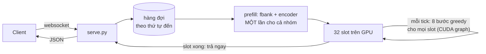

# Giai đoạn 2: bản lite

[Giai đoạn 1](PHASE1.md) đo server C++ gốc của sherpa-onnx. Giai đoạn này làm bản lite, một server Python viết lại theo
cách của vieneu lite, rồi đo nó với sherpa trên cùng loại máy, cùng client đo, cùng bộ câu.

Lite giữ nguyên hai thứ:

- **Giao thức websocket và JSON trả về của sherpa:** client cũ dùng được nguyên.
- **File model:** đúng ba file ONNX mà sherpa dùng, không train lại.

Code nằm trong [lite/](lite/), chỉ có Python.

## Tóm tắt

| Kịch bản | Người dùng tối đa (P90 ≤ 1 s), sherpa | Người dùng tối đa (P90 ≤ 1 s), lite | Trần xử lý, sherpa | Trần xử lý, lite |
|---|---:|---:|---:|---:|
| Dồn một lúc, câu ~10 s | 24 | **64** | 422 | **711** |
| Dồn một lúc, câu 1.4–33 s | 16 | **48** | 282 | **394** |
| Rải đều, câu ~10 s | 128 | **320** | **515** | 352 |
| Rải đều, câu 1.4–33 s | 64 | **192** | 112 | **264** |

"Dồn một lúc" và "rải đều" là hai cách gửi request khi đo, giải thích ở [mục ngay dưới](#hai-cách-gửi-request-khi-đo).
"Trần xử lý" là số giây audio server chép ra chữ trong một giây khi đã hết sức.

- **Một câu 10 s chạy một mình:** lite trả chữ sau 0.07 s, sherpa 0.13 s.
- **Độ đúng:** trên GPU, 355/355 câu của lite giống hệt sherpa, WER không đổi ở mọi mức tải.
- **Lite thắng ở hầu hết mọi chỗ:** độ trễ thấp hơn 2–4 lần, và số người phục vụ được trong mốc 1 s nhiều hơn 2.5–3 lần.
- **Lite thua ở một chỗ:** khi request rải đều và tải cực cao (từ ~384 người nói cùng lúc với câu ~10 s), lite hết sức
  trước sherpa. Lý do và cách sửa ở [phần kết quả](#rải-đều-câu-10-s).
- **Audio dài:** lite cắt thành cửa sổ 30 s rồi ghép lại, không làm sai chữ. WER 2.19% trên file 1–5 phút, so với 2.25%
  khi chép từng câu riêng.
- **VRAM:** đã có trần, nhưng chưa phẳng hoàn toàn (xem [mục VRAM](#vram)).

## Hai cách gửi request khi đo

Cả hai cách đều tăng dần số người dùng N, xem server chịu được tới đâu. Khác nhau ở chỗ **request đến server lúc nào**.

### Dồn một lúc

N người **bấm gửi đúng cùng một khoảnh khắc**, mỗi người một câu. Đợi đủ N người nhận chữ thì cả N lại gửi tiếp. Mỗi mức
chạy 2 lượt khởi động rồi 5 lượt đo.

```
N = 4, mỗi câu 10 s

t = 0 s      người 1, 2, 3, 4 cùng gửi   →  server nhận 4 câu trong cùng một tích tắc
t ≈ 0.13 s   cả 4 đã nhận chữ             →  lượt sau, lại cùng gửi 4 câu
```

- Thời gian chờ: tính từ lúc gửi đến lúc nhận chữ.
- Giống tình huống: đỉnh tải đột ngột, nhiều người bấm "chép lời" hay upload file cùng lúc.

### Rải đều

N người **đang nói liên tục**. Mỗi người nói xong một câu thì câu đó được gửi ngay, trong khi người đó nói tiếp câu sau.
Mỗi người bắt đầu lệch nhau một chút. Vì vậy **request không đến cùng lúc mà rải đều theo thời gian**:

```
N = 3, mỗi câu 10 s, mỗi người bắt đầu lệch nhau

người A   ──── nói câu 1 ────┤gửi  ──── nói câu 2 ────┤gửi  ──── nói câu 3 ────┤gửi
người B          ──── nói câu 1 ────┤gửi  ──── nói câu 2 ────┤gửi  ────
người C   ── nói câu 1 ──┤gửi  ──── nói câu 2 ────┤gửi  ──── nói câu 3 ────┤gửi
thời gian 0 s ─────────────────────────── 10 s ─────────────────────────── 20 s ──────────►
```

Mỗi người 10 giây mới gửi một câu, nên **số request đến mỗi giây chỉ khoảng N chia độ dài câu**:

| N người nói cùng lúc | Request đến mỗi giây (câu ~10 s) | Trung bình cứ bao lâu có một request |
|---:|---:|---:|
| 128 | 12.8 | 78 ms |
| 320 | 32 | 31 ms |
| 512 | 51 | 20 ms |

Số trong bảng đo trực tiếp từ client. **N ở đây là số người đang nói cùng lúc (CCU), không phải số request đến cùng một
khoảnh khắc**: tại một thời điểm bất kỳ, server chỉ đang nhận vài request.

- Thời gian chờ: tính từ lúc câu nói xong đến lúc nhận chữ, gồm cả thời gian xếp hàng. Nếu server không theo kịp, hàng đợi
  dài dần và thời gian chờ tăng không dừng: đó là lúc quá tải.
- Mỗi mức chạy 60 giây, bỏ 10 giây đầu. Mỗi người chỉ có một câu đang chờ kết quả.
- Giống tình huống: tổng đài hay voice agent có N cuộc gọi đang diễn ra, VAD cắt lời thành từng câu.
- Đây là mức tải nặng nhất của kiểu này: người dùng nói liền không nghỉ. Người thật có lúc im lặng, nên tạo ít request hơn.

## Cách đo

- **Client đo** ([lite/loadtest.py](lite/loadtest.py)) chạy ngay trên máy GPU, chia người dùng cho 8 tiến trình, nói đúng
  giao thức websocket của sherpa. Cùng một client đo cả hai server, nên khác biệt chỉ nằm ở server. Độ trễ mạng giữa máy
  mình và máy GPU không lọt vào số nào.
- **Audio:** LibriSpeech test-clean, câu tiếng Anh đọc thật, bộ test của chính model này.

  | Bộ | Gồm |
  |---|---|
  | Câu ~10 s | 55 câu dài 9.75–10.25 s |
  | Câu 1.4–33 s | 300 câu lấy ngẫu nhiên, độ dài tự nhiên |
  | Audio dài | 97 file 71–300 s, nối các câu liên tiếp của cùng một chương, chèn 0.3 s im lặng giữa các câu |

- **Mức đạt:** mọi request thành công và P90 thời gian chờ ≤ 1 s. P50/P90 tính trên mọi request của một mức.
- **Độ đúng:** trước mỗi kịch bản, client chép từng câu một mình để làm mốc; lúc có tải, mọi câu được so với mốc đó và
  tính WER so với transcript gốc.
- **Cấu hình:** sherpa dùng mặc định (batch tối đa 5, 3 luồng). Lite tắt tính năng từ chối (`--max-pending-seconds=0`) để
  hai bên cùng điều kiện.
- **Ngày đo:** sherpa đo ngày 17/10, lite ngày 18/10, trên hai máy RTX 3060 12 GB khác nhau. Số tuyệt đối chỉ đúng cho máy
  đã đo; chênh lệch giữa hai bản lớn hơn nhiều so với độ lệch giữa hai máy.

## Lite khác sherpa ở đâu

| | Sherpa C++ | Lite |
|---|---|---|
| Gom batch | Lấy tối đa 5 câu đang chờ, chạy encoder rồi greedy cho cả batch; cả batch xong mới trả | 32 slot cố định. Prefill (fbank + encoder) **một lần cho cả nhóm câu mới vào**, rồi greedy chạy theo bước cho mọi slot. **Câu nào xong là trả ngay**, câu mới vào thế chỗ ở tick sau |
| Vòng greedy | Chạy trên CPU, mỗi bước chép dữ liệu CPU ↔ GPU | Chạy hẳn trên GPU, 8 bước ghi lại thành một CUDA graph, mỗi tick chỉ một lệnh. 8 bước cho 32 slot mất ~1 ms |
| Fbank | Trên CPU, trong lúc giữ khóa hàng đợi | Bằng torch trên GPU, cả nhóm một lần. Lệch tối đa 0.0002 so với thư viện sherpa dùng |
| Audio dài | Đưa nguyên file vào encoder (tối đa 300 s) | Cắt thành cửa sổ 30 s theo cách của icefall, rồi ghép lại |
| Quá tải | Hàng đợi không giới hạn, chờ mãi | Có thể từ chối ngay (`{"error": "busy"}`); khi đo thì tắt |

Đường đi của một câu trong lite ([engine.py](lite/zipformer_lite/engine.py)):



## Kết quả

Bảng đầy đủ tính lại bằng `python3 experiments/lite/analyze.py`.

### Dồn một lúc, câu ~10 s

| Người dùng | P50 / P90, sherpa | P50 / P90, lite | Xử lý, sherpa | Xử lý, lite |
|---:|---:|---:|---:|---:|
| 1 | 0.13 / 0.15 s | 0.07 / 0.07 s | 76 s/giây | 144 s/giây |
| 8 | 0.53 / 0.75 s | 0.14 / 0.17 s | 132 s/giây | 531 s/giây |
| 16 | 0.68 / 0.87 s | 0.24 / 0.24 s | 188 s/giây | 650 s/giây |
| 24 | 0.71 / 0.99 s | 0.36 / 0.39 s | 249 s/giây | 650 s/giây |
| 32 | 0.96 / 1.33 s | 0.44 / 0.47 s | 236 s/giây | 692 s/giây |
| 64 | 1.11 / 1.65 s | 0.81 / 0.88 s | 364 s/giây | 711 s/giây |
| 128 | 1.81 / 2.75 s | 1.31 / 1.79 s | 422 s/giây | 699 s/giây |

Câu dồn tới một lúc, nên mỗi lượt prefill của lite gom được 8–11 câu và chi phí của encoder được chia đều.

### Dồn một lúc, câu 1.4–33 s

| Người dùng | P50 / P90, sherpa | P50 / P90, lite | Xử lý, sherpa | Xử lý, lite |
|---:|---:|---:|---:|---:|
| 1 | 0.13 / 0.19 s | 0.06 / 0.10 s | 85 s/giây | 161 s/giây |
| 8 | 0.49 / 0.62 s | 0.21 / 0.30 s | 116 s/giây | 278 s/giây |
| 16 | 0.46 / 0.77 s | 0.32 / 0.40 s | 157 s/giây | 315 s/giây |
| 32 | 0.57 / 1.22 s | 0.47 / 0.63 s | 176 s/giây | 394 s/giây |
| 48 | 0.76 / 1.25 s | 0.77 / 0.99 s | 244 s/giây | 378 s/giây |
| 64 | 0.89 / 1.98 s | 1.10 / 1.25 s | 207 s/giây | 372 s/giây |
| 128 | 1.51 / 2.81 s | 1.61 / 2.53 s | 282 s/giây | 357 s/giây |

Câu ngắn không phải chờ câu dài trong cùng batch, vì slot nào xong là trả ngay.

### Rải đều, câu ~10 s

| Người nói cùng lúc | Request đến mỗi giây | P50 / P90, sherpa | P50 / P90, lite | Xử lý, sherpa | Xử lý, lite |
|---:|---:|---:|---:|---:|---:|
| 32 | 3.2 | 0.15 / 0.19 s | 0.08 / 0.12 s | 32 s/giây | 32 s/giây |
| 128 | 12.8 | 0.33 / 0.77 s | 0.12 / 0.22 s | 127 s/giây | 129 s/giây |
| 192 | 19.2 | 0.86 / 1.31 s | 0.16 / 0.33 s | 194 s/giây | 193 s/giây |
| 256 | 25.7 | 0.91 / 1.31 s | 0.21 / 0.44 s | 253 s/giây | 255 s/giây |
| 320 | 32.0 | 0.87 / 1.28 s | 0.29 / 0.69 s | 317 s/giây | 320 s/giây |
| 384 | 38.5 | 0.85 / 1.20 s | 3.71 / 5.32 s (quá tải) | 387 s/giây | 352 s/giây |
| 512 | 51.2 | 1.32 / 1.73 s | — | 506 s/giây | — |
| 640 | 60.1 | 9.46 / 14.26 s (quá tải) | — | 515 s/giây | — |

N người nói liền tạo ra N giây audio mỗi giây. Khi cột "Xử lý" thấp hơn N là server đã không theo kịp.

- **Tới 320 người, lite trả chữ nhanh hơn 2–4 lần.** Trong mốc P90 ≤ 1 s, lite phục vụ được 320 người, sherpa 128.
- **Từ 384 người, lite hết sức trước.** Lite chỉ theo kịp tới ~350 giây audio mỗi giây, sherpa tới ~515.

Vì sao lite hết sức trước ở đây:

1. **Request đến rải rác,** cứ ~26 ms một câu ở mức 384 người.
2. **Lite chạy prefill ngay khi có câu.** Mỗi tick chỉ ~1 ms, nên mỗi lượt prefill chỉ gom được 1–2 câu (đo được trung bình
   1.6–1.7 câu).
3. **Mỗi lượt encoder có chi phí cố định lớn,** khoảng 20+ ms dù chỉ có 1 câu. Lúc đó prefill chiếm 88–96% thời gian của
   luồng GPU, nên encoder không theo kịp nữa.
4. **Sherpa thì gom đủ 5 câu mỗi batch khi đông** (đo được trung bình 5.0 ở 512 người), và có 3 luồng chạy chồng lên nhau
   nên giấu được chi phí cố định.

Giống xe buýt: lite cho xe chạy ngay khi có 1–2 khách, nên khách đợi ít; nhưng lúc cực đông thì số chuyến không đủ. Sherpa
đợi đủ 5 khách mới chạy và có 3 xe chạy xen nhau. Cách sửa (chưa làm): khi hàng đợi bắt đầu dài, cho prefill chờ thêm vài
ms để gom nhiều câu hơn; hoặc làm encoder rẻ hơn (fp16, TensorRT).

Ở kịch bản dồn một lúc không có chuyện này, vì câu đến cùng lúc nên lite gom được 8–16 câu mỗi lượt.

### Rải đều, câu 1.4–33 s

| Người nói cùng lúc | Request đến mỗi giây | P50 / P90, sherpa | P50 / P90, lite | Xử lý, sherpa | Xử lý, lite |
|---:|---:|---:|---:|---:|---:|
| 32 | 4.6 | 0.16 / 0.25 s | 0.08 / 0.14 s | 32 s/giây | 32 s/giây |
| 64 | 8.9 | 0.20 / 0.33 s | 0.09 / 0.17 s | 63 s/giây | 63 s/giây |
| 128 | 15.7 | 3.56 / 7.03 s (quá tải) | 0.13 / 0.29 s | 112 s/giây | 124 s/giây |
| 192 | 26.6 | — | 0.21 / 0.48 s | — | 190 s/giây |
| 256 | 34.6 | — | 0.49 / 1.37 s | — | 245 s/giây |
| 320 | 35.8 | — | 7.44 / 14.15 s (quá tải) | — | 264 s/giây |

Với câu dài ngắn lẫn lộn, sherpa phải đệm cả batch theo câu dài nhất, nên quá tải ở 128 người. Lite chỉ đệm trong lượt
prefill, vòng greedy chạy đúng độ dài thật của từng câu, nên chịu được tới 192 người trong mốc 1 s, gấp 3 lần.

## Audio dài

**Sherpa** không chia gì: nó đưa nguyên file vào encoder, tối đa 300 s. Encoder nhìn cả file một lúc, nên bộ nhớ tăng theo
bình phương độ dài. Chưa đo sherpa với file dài trên GPU.

**Lite** làm theo cách của chính tác giả Zipformer, recipe `long_file_recog` của icefall:

1. Cắt file thành **cửa sổ 30 s, cứ 26 s một cửa sổ**, hai cửa sổ liền nhau chồng 4 s.
2. Mỗi cửa sổ là một câu bình thường trong slot, prefill chung với các request khác. Một file 5 phút thành 12 cửa sổ chạy
   song song.
3. Mỗi cửa sổ chỉ giữ token nằm từ giây thứ 2 tới giây thứ 28 của nó (cửa sổ đầu giữ từ 0, cửa sổ cuối giữ tới hết). Các
   phần giữ lại nối tiếp nhau, nên chỉ việc nối token theo thứ tự.

Encoder không bao giờ nhận quá 30 s, dù file dài bao nhiêu.

| Kiểm tra | Kết quả |
|---|---|
| 97 file dài (71–300 s), mỗi file chạy một mình | WER **2.19%**, trả chữ sau 0.40 s cho file trung bình 207 s |
| Cùng nội dung đó, chép từng câu một (2,603 câu) | WER **2.25%** |

Cắt cửa sổ không làm sai chữ, thậm chí nhỉnh hơn một chút nhờ được nhìn qua ranh giới giữa các câu.

Nhiều người gửi file dài cùng lúc:

| Người dùng | P50 / P90 thời gian chờ | Xử lý | WER |
|---:|---:|---:|---:|
| 1 | 0.48 / 0.52 s | 520 s/giây | 2.25% |
| 4 | 1.17 / 1.65 s | 574 s/giây | 2.15% |
| 8 | 1.95 / 2.45 s | 606 s/giây | 1.41% |
| 16 | 3.29 / 5.10 s | 587 s/giây | 1.88% |

Ở mức 8 và 16 người, vài file cho chữ hơi khác lúc chạy một mình, vì chỗ nối cửa sổ được đệm khác nhau khi chung nhóm;
WER không tệ đi.

## VRAM

| | Lúc bắt đầu | Sau khi chạy | Ghi chú |
|---|---:|---:|---|
| Sherpa | ~1 GB | 6.6 GB | Tăng theo kích thước batch lớn nhất từng gặp, không trần |
| Lite, bản đo ở các bảng trên | 4.1 GB | 7.7 GB | Bước làm nóng chưa phủ hết các hình dạng prefill |
| Lite, làm nóng theo "đường biên" | 7.2 GB | 7.2 GB qua 4 kịch bản và audio dài (+60 MB) | Nhưng sau 2,603 câu với độ dài đủ kiểu: 8.4 GB |

- **Lite có trần.** Mỗi lượt prefill tối đa 16 câu và 240 s audio sau khi đệm, mỗi cửa sổ tối đa 30 s, và onnxruntime bị
  giới hạn 8 GB.
- **Làm nóng theo "đường biên":** lúc khởi động, với mỗi số câu g từ 1 tới 16, lite chạy một nhóm g câu ở độ dài lớn nhất được
  phép. Mọi nhóm gặp sau đó đều không lớn hơn một nhóm đã chạy.
- **Nhưng chưa phẳng hoàn toàn.** Khi gặp hàng nghìn kích thước khác nhau, bộ cấp phát bị phân mảnh và xin thêm vùng mới.
- **Đã code, chưa đo:** cờ `--shrink-arena=1` cho onnxruntime trả lại bộ nhớ thừa sau mỗi lượt; số VRAM riêng của torch
  trong `/health` để biết phần tăng nằm ở đâu.
- **Không đệm lên các độ dài cố định được,** vì encoder ONNX lấy mask theo câu dài nhất trong nhóm: đệm dài hơn thì báo lỗi.

## Trạng thái

| Việc | Trạng thái |
|---|---|
| Slot + continuous batching, prefill một lần cho cả nhóm | Xong, đã đo |
| Vòng greedy bằng CUDA graph | Xong, đã đo |
| Fbank trên GPU | Xong, đã kiểm tra khớp sherpa |
| Audio dài: cửa sổ 30 s theo icefall | Xong, đã đo |
| VRAM có trần | Xong |
| VRAM phẳng hoàn toàn | Chưa: còn phân mảnh khi độ dài thay đổi nhiều |
| Từ chối khi bận | Code xong, chưa đo |
| Trần khi tải rải đều rất cao | Chưa: cần gom prefill to hơn hoặc encoder rẻ hơn |
| Encoder chạy song song với greedy | Chưa làm |

## Khác biệt cần biết

- **onnxruntime 1.26** thay vì 1.28 như bản C++ của sherpa: 1.26 là bản cuối trên PyPI build cho CUDA 12.
- **Chỉ nhận audio 16 kHz.** Sherpa tự resample, lite trả lỗi.
- **Nhận file tối đa 300 s** như sherpa; dài hơn thì trả `{"error": "too_long"}`.
- **Các flag cũ của sherpa** (`--max-batch-size`, `--num-work-threads`, đường dẫn model, …) vẫn được nhận nhưng bỏ qua,
  kèm cảnh báo.
- **Số lite trong các bảng chính** đo bằng bản trước khi có cửa sổ 30 s (giới hạn câu 35 s, thư mục `lite-c`). Bản có cửa
  sổ (`lite-d`) cho số gần như y hệt ở 4 kịch bản: 64, 48, 320 và 192 người.

## Các tham số

| Cờ | Mặc định | Ý nghĩa |
|---|---|---|
| `--num-slots` | 32 | Số cửa sổ được giải mã cùng lúc |
| `--steps` | 8 | Số bước greedy mỗi tick |
| `--max-utterance-length` | 300 | Từ chối request dài hơn số giây này |
| `--window-seconds`, `--window-extra` | 30, 2 | Cửa sổ cho audio dài, và phần chồng mỗi bên |
| `--admit-max`, `--admit-max-seconds` | 16, 240 | Một lượt prefill tối đa bao nhiêu cửa sổ và bao nhiêu giây audio sau khi đệm |
| `--max-pending-seconds` | 120 | Từ chối khi lượng audio đang chờ vượt số giây này. `0` = không bao giờ từ chối |
| `--gpu-mem-gb` | 8 | Giới hạn bộ nhớ GPU của onnxruntime |
| `--cuda-graph` | 1 | `0` = chạy greedy từng lệnh, để so sánh |
| `--shrink-arena` | 0 | `1` = onnxruntime trả lại bộ nhớ thừa sau mỗi lượt (chưa đo) |

## Máy đo

| Thông số | Giá trị |
|---|---|
| GPU | NVIDIA GeForce RTX 3060 12 GB, driver 595.104.02, UUID `GPU-17003539-7e1c-a01d-d78b-d0f3e20544a0` |
| Máy thuê | VKong `vk_0b6a76a1700ab3f0`, Việt Nam, $0.084/giờ, container `75931ba6ba31` |
| Image | `pytorch/pytorch:2.8.0-cuda12.8-cudnn9-runtime`: torch 2.8.0, onnxruntime-gpu 1.26.0, Python 3.11.13 |
| Xung nhịp GPU | Không khóa được, tới 1972 MHz khi có tải |
| Nhiệt độ GPU | 52–71 °C |
| Số request | 53,324, không lỗi nào |
| Chi phí | Khoảng 4 giờ máy, gồm cả các lần thử, khoảng $0.35 |

Máy của sherpa: xem [PHASE1.md](PHASE1.md#phương-pháp-đo).

## Chạy lại

Cần CLI của VKong đã đăng nhập. Chạy từ thư mục gốc của repo.

```bash
vkong run -C lite --detach                                   # thuê máy, cài thư viện, tải model và LibriSpeech
vkong instances                                              # lấy id của máy, dạng vk_xxxx
bash experiments/lite/keep_tunnel.sh vk_xxxx /tmp/lite-url & # giữ tunnel, tự nối lại khi đứt
bash experiments/lite/run_suite.sh @/tmp/lite-url lite "max_pending_seconds=0"
SCENARIOS="burst-long long-utts" bash experiments/lite/run_suite.sh @/tmp/lite-url lite "max_pending_seconds=0"
python3 experiments/lite/fetch.py $(cat /tmp/lite-url) --run my-rerun --servers lite
vkong app stop zipformer-asr-lite --yes                      # Ctrl+C không trả máy
```

Kiểm tra lite cho ra đúng chữ như sherpa (cần `pip install kaldi-native-fbank sherpa-onnx`):

```bash
cd lite && python check.py --device cpu --per-set 16
```

## Code

| File | Việc |
|---|---|
| [lite/serve.py](lite/serve.py) | Websocket theo giao thức sherpa, `/health` |
| [lite/zipformer_lite/engine.py](lite/zipformer_lite/engine.py) | Slot, prefill theo nhóm, các bước greedy, cửa sổ cho audio dài, từ chối |
| [lite/zipformer_lite/transducer.py](lite/zipformer_lite/transducer.py) | Prefill (fbank + encoder ONNX trên GPU), decoder và joiner bằng torch, tạo JSON |
| [lite/zipformer_lite/fbank.py](lite/zipformer_lite/fbank.py) | Fbank kiểu Kaldi bằng torch |
| [lite/check.py](lite/check.py) | So fbank và chữ với sherpa |
| [lite/bench.py](lite/bench.py), [lite/loadtest.py](lite/loadtest.py), [lite/audio.py](lite/audio.py) | Chạy trên máy GPU: bật server, chạy client đo, bộ câu LibriSpeech |
| [lite/results/gpu-20261018/](lite/results/gpu-20261018/) | Số đo thô: `lite-c` (bảng chính), `lite-d` (cửa sổ, audio dài, VRAM) |
| [experiments/lite/](experiments/lite/) | `run_suite.sh`, `keep_tunnel.sh`, `fetch.py`, `analyze.py` |
