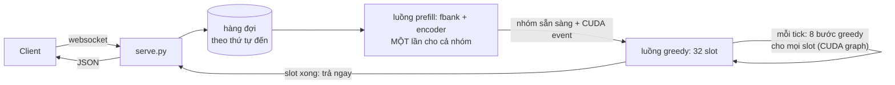

# Giai đoạn 2: bản lite và tối ưu (18/10/2026)

Hết [giai đoạn 1](PHASE1.md), baseline là server C++ gốc của sherpa-onnx. Giai đoạn này viết lại server bằng Python theo
cách của vieneu lite, rồi làm theo thứ tự: đo so với sherpa, tìm chỗ yếu, đọc số đo để hiểu vì sao, sửa, kiểm tra chữ
không đổi, rồi đo lại.

Model giữ nguyên: đúng ba file ONNX mà sherpa dùng, greedy search theo đúng luật của sherpa. Giao thức websocket và JSON
trả về cũng giữ nguyên, nên client của sherpa dùng được luôn. Code nằm trong [lite/](lite/), chỉ có Python.

## Kết quả

Bản lite cuối so với server C++ gốc của sherpa, model Zipformer gốc tiếng Anh, một RTX 3060 12 GB:

| Kịch bản | Người dùng tối đa (P90 ≤ 1 s), sherpa | Người dùng tối đa (P90 ≤ 1 s), lite | Trần xử lý, sherpa | Trần xử lý, lite |
|---|---:|---:|---:|---:|
| Dồn một lúc, câu ~10 s | 24 | **64** | 422 | **825** |
| Dồn một lúc, câu 1.4–33 s | 16 | **64** | 282 | **552** |
| Rải đều, câu ~10 s | 128 | **768** | 515 | **916** |
| Rải đều, câu 1.4–33 s | 64 | **320** | 112 | **394** |

"Dồn một lúc" và "rải đều" là hai cách gửi request khi đo, giải thích ở [mục ngay dưới](#cách-đo). "Trần xử lý" là số
giây audio server chép ra chữ trong một giây khi đã hết sức.

- **Số người phục vụ được trong mốc 1 s nhiều hơn 2.7–6 lần,** trần xử lý cao hơn 1.8–3.5 lần.
- **Một câu ~10 s chạy một mình:** 0.135 → 0.076 s.
- **Chữ không đổi.** Trên GPU, 355/355 câu giống hệt sherpa (bước 2). Lúc có tải, WER không đổi.
- **Audio dài tới 5 phút:** cắt thành cửa sổ 30 s rồi ghép lại, WER 2.19%, so với 2.25% khi chép từng câu riêng (bước 4).
- **VRAM giữ được dưới ngưỡng đặt trước,** dù độ dài câu thay đổi liên tục (bước 7).
- **Không lỗi nào** trong 68,771 request của lần đo cuối.

Máy đo và cách kiểm tra lại các bảng: [bước 8](#bước-8-bench-cuối-so-với-sherpa).

## Cách đo

Đo đúng như giai đoạn 1 (xem [Phương pháp đo](PHASE1.md#phương-pháp-đo)). Cả hai cách gửi request đều tăng dần số người
dùng N, xem server chịu được tới đâu. Chúng khác nhau ở chỗ **request đến server lúc nào**.

**Dồn một lúc.** N người **bấm gửi đúng cùng một khoảnh khắc**, mỗi người một câu. Đợi đủ N người nhận chữ thì cả N lại
gửi tiếp. Mỗi mức chạy 2 lượt khởi động rồi 5 lượt đo. Thời gian chờ tính từ lúc gửi đến lúc nhận chữ. Giống tình huống
đỉnh tải đột ngột: nhiều người bấm "chép lời" hay upload file cùng lúc.

```
N = 4, mỗi câu 10 s

t = 0 s      người 1, 2, 3, 4 cùng gửi   →  server nhận 4 câu trong cùng một tích tắc
t ≈ 0.1 s    cả 4 đã nhận chữ             →  lượt sau, lại cùng gửi 4 câu
```

**Rải đều.** N người **đang nói liên tục**. Mỗi người nói xong một câu thì câu đó được gửi ngay, trong khi người đó nói
tiếp câu sau. Mỗi người bắt đầu lệch nhau một chút, nên **request không đến cùng lúc mà rải đều theo thời gian**:

```
N = 3, mỗi câu 10 s

người A   ──── nói câu 1 ────┤gửi  ──── nói câu 2 ────┤gửi  ──── nói câu 3 ────┤gửi
người B          ──── nói câu 1 ────┤gửi  ──── nói câu 2 ────┤gửi  ────
người C   ── nói câu 1 ──┤gửi  ──── nói câu 2 ────┤gửi  ──── nói câu 3 ────┤gửi
thời gian 0 s ─────────────────────────── 10 s ─────────────────────────── 20 s ──────────►
```

Mỗi người 10 giây mới gửi một câu, nên số request đến mỗi giây chỉ khoảng N chia độ dài câu:

| N người nói cùng lúc | Request đến mỗi giây (câu ~10 s) | Trung bình cứ bao lâu có một request |
|---:|---:|---:|
| 128 | 12.8 | 78 ms |
| 320 | 32 | 31 ms |
| 768 | 77 | 13 ms |

- **N là số người đang nói cùng lúc (CCU),** không phải số request đến cùng một khoảnh khắc.
- **Thời gian chờ** tính từ lúc câu nói xong đến lúc nhận chữ, gồm cả thời gian xếp hàng. Server không theo kịp thì hàng đợi
  dài dần và thời gian chờ tăng không dừng: đó là lúc quá tải.
- **Mỗi mức** chạy 60 giây, bỏ 10 giây đầu. Mỗi người chỉ có một câu đang chờ kết quả.
- **Giống tình huống** tổng đài hay voice agent có N cuộc gọi, VAD cắt lời thành từng câu. Người dùng ở đây nói liền
  không nghỉ, nên đây là mức tải nặng nhất của kiểu này.

**Những điểm chung:**

- **Client đo** ([lite/loadtest.py](lite/loadtest.py)) chạy ngay trên máy GPU, chia người dùng cho 8 tiến trình, nói đúng
  giao thức của sherpa. Cùng một client đo cả hai server.
- **Audio:** LibriSpeech test-clean. Có 55 câu dài 9.75–10.25 s, 300 câu lấy ngẫu nhiên dài 1.4–33 s, và 97 file dài
  71–300 s, mỗi file nối các câu liên tiếp của một chương.
- **Mức đạt:** mọi request thành công và P90 thời gian chờ ≤ 1 s.
- **Độ đúng:** trước mỗi kịch bản, client chép từng câu một mình để làm mốc. Lúc có tải, mọi câu được so với mốc đó và
  tính WER so với transcript gốc.
- **Cấu hình:** sherpa chạy mặc định (batch tối đa 5, 3 luồng). Lite tắt tính năng từ chối (`--max-pending-seconds=0`)
  để hai bên cùng điều kiện.

## Các cờ

Các cờ của `lite/serve.py`. Khi đo, `bench.py` nhận chúng qua `POST /server?...`:

| Cờ | Mặc định | Ý nghĩa |
|---|---|---|
| `--num-slots` | 32 | Số cửa sổ được giải mã cùng lúc |
| `--steps` | 8 | Số bước greedy mỗi tick, ghi chung một CUDA graph |
| `--cuda-graph` | 1 | `0`: chạy greedy từng lệnh, để so |
| `--admit-max`, `--admit-max-seconds` | 16, 240 | Một lượt prefill tối đa bao nhiêu cửa sổ, và bao nhiêu giây audio sau khi đệm |
| `--window-seconds`, `--window-extra` | 30, 2 | Cửa sổ cho audio dài, và phần chồng mỗi bên |
| `--max-utterance-length` | 300 | Từ chối request dài hơn số giây này |
| `--max-pending-seconds` | 120 | Từ chối ngay khi lượng audio đang chờ vượt số giây này. `0`: không bao giờ từ chối |
| `--gpu-mem-gb` | 8 | Giới hạn cứng bộ nhớ GPU của onnxruntime |
| `--vram-release-gb` | 0 | VRAM của cả GPU vượt số này (GiB) thì onnxruntime trả bộ nhớ trống về CUDA. `0`: không bao giờ |

## Bước 1. Dựng bản lite

Mục tiêu: server Python gọn, cùng giao thức và cùng model với sherpa, nhưng không gom batch tĩnh.

Ở [giai đoạn 1](PHASE1.md#server-sherpa-onnx-xử-lý-một-câu-như-thế-nào), server của sherpa lấy tối đa 5 câu đang chờ, chạy
encoder rồi greedy cho cả batch, và cả batch xong mới trả. Vòng greedy chạy trên CPU, mỗi bước chép dữ liệu qua lại giữa
CPU và GPU. Lite đổi các chỗ đó:

| | Sherpa C++ | Lite |
|---|---|---|
| Gom batch | Tối đa 5 câu, cả batch xong mới trả | 32 slot cố định. Prefill (fbank + encoder) **một lần cho cả nhóm câu mới vào**, rồi greedy chạy từng bước cho mọi slot. **Câu nào xong là trả ngay**, câu mới vào thế chỗ ở tick sau |
| Vòng greedy | Trên CPU, mỗi bước chép CPU ↔ GPU | Hẳn trên GPU. 8 bước ghi thành một CUDA graph, mỗi tick chỉ một lệnh. 8 bước cho 32 slot mất ~1 ms |
| Fbank | Trên CPU, trong lúc giữ khóa hàng đợi | Bằng torch trên GPU, cả nhóm một lần |
| Decoder, joiner | ONNX | Viết lại bằng torch, trọng số đọc từ chính file ONNX |
| Quá tải | Hàng đợi không giới hạn | Có thể từ chối ngay (`{"error": "busy"}`) |

Mỗi tick của vòng lặp, trên một luồng giữ GPU:

1. **Nạp.** Còn slot trống thì lấy tối đa min(slot trống, 16) câu đang chờ, theo thứ tự đến, như vieneu lite. Chạy fbank và
   encoder một lần cho cả nhóm, đệm theo câu dài nhất, rồi chép kết quả của từng câu vào slot của nó. Chỉ lượt prefill
   này có đệm; vòng greedy không có.
2. **Bước.** 8 bước greedy cho mọi slot cùng lúc, theo luật của sherpa: mỗi frame tối đa một token, `<unk>` tính như
   blank. Mỗi slot có frame riêng. Slot trống hay đã xong vẫn chạy theo nhưng bị che, nên mỗi bước luôn là cùng một bộ
   kernel. Nhờ vậy 8 bước ghi được thành một CUDA graph.
3. **Thu.** Chép về CPU danh sách slot đã xong, trả kết quả và giải phóng slot ngay.

Code: [engine.py](lite/zipformer_lite/engine.py) (slot, vòng lặp), [transducer.py](lite/zipformer_lite/transducer.py)
(prefill, decoder, joiner, JSON trả về), [fbank.py](lite/zipformer_lite/fbank.py) (fbank kiểu Kaldi bằng torch).

## Bước 2. Kiểm tra chữ không đổi

Mục tiêu: chứng minh lite cho đúng chữ như sherpa trước khi đo tốc độ.

- **Fbank:** lệch tối đa 0.0002 so với kaldi-native-fbank, thư viện sherpa dùng, với cùng các tùy chọn.
- **Chữ:** [check.py](lite/check.py) gửi cùng lúc một loạt câu vào engine, để có đủ nhóm, đệm, che và slot được dùng lại.
  Sau đó nó so từng câu với `sherpa_onnx`. Trên GPU, 355/355 câu (55 câu ~10 s và 300 câu lẫn lộn) giống hệt server
  C++ của sherpa.
- **Lúc có tải:** ở mọi mức, 99.2–100% câu cho đúng chữ như khi chạy một mình, WER không đổi. Phần nhỏ khác đi là do câu
  được đệm khác nhau tùy nhóm.

```bash
pip install kaldi-native-fbank sherpa-onnx
cd lite && python check.py               # trên GPU
python check.py --device cpu --per-set 8  # ở đâu cũng chạy được, chậm hơn
```

## Bước 3. Đo lần đầu, tìm chỗ yếu

Mục tiêu: đo bản lite một luồng so với sherpa ở cả bốn kịch bản.

| Kịch bản | Người dùng tối đa: sherpa / lite một luồng | Trần xử lý: sherpa / lite một luồng |
|---|---:|---:|
| Dồn một lúc, câu ~10 s | 24 / 64 | 422 / 711 |
| Dồn một lúc, câu 1.4–33 s | 16 / 48 | 282 / 394 |
| Rải đều, câu ~10 s | 128 / 320 | **515 / 352** |
| Rải đều, câu 1.4–33 s | 64 / 192 | 112 / 264 |

Lite thắng ở mọi chỗ, trừ trần xử lý khi rải đều với câu ~10 s. Ở 384 người nói cùng lúc, P90 của lite nhảy lên 5.3 s,
trong khi sherpa vẫn chịu được tới 512 người, ở mức P90 1.7 s.

Server ghi lại mỗi lượt prefill gom bao nhiêu câu và chiếm bao nhiêu thời gian:

| Người nói cùng lúc | P90 | Câu mỗi lượt prefill | Phần thời gian luồng GPU dành cho prefill |
|---:|---:|---:|---:|
| 128 | 0.22 s | 1.15 | 75% |
| 256 | 0.44 s | 1.49 | 85% |
| 320 | 0.69 s | 1.72 | 88% |
| 384 | 5.32 s | 1.65 | 96% |

Đọc ra:

- **Request đến rải rác,** ở 384 người là cứ ~26 ms một câu. Lite chạy prefill ngay khi có câu, nên mỗi lượt chỉ gom được
  1–2 câu. Mỗi lượt encoder có chi phí cố định lớn, dù chỉ 1 câu.
- **Prefill chạy thì greedy phải dừng,** vì cả hai cùng một luồng. Khi gần như tick nào cũng có câu mới, mỗi vòng thành
  "vài chục ms prefill + 1 ms greedy".
- **Tính thử:** ~40 vòng mỗi giây × 8 bước = 320 frame mỗi giây cho mỗi slot. Đó là 12.8 s audio mỗi giây (một frame là
  40 ms), nhân 32 slot thì ≈ 410 giây audio mỗi giây, gần với trần ~350 đo được.
- **Sherpa thì gom đủ 5 câu mỗi batch khi đông,** và có 3 luồng chạy chồng lên nhau, nên giấu được chi phí cố định.

**Kết luận:** chỗ yếu không phải encoder tính chậm, mà là encoder và greedy phải chờ nhau trên cùng một luồng. Sửa ở
bước 6.

Số liệu: [lite/results/gpu-20261018/lite-c/](lite/results/gpu-20261018/lite-c/).

## Bước 4. Audio dài: cửa sổ 30 s

Mục tiêu: nhận file tới 300 s mà encoder không bao giờ phải nhìn quá 30 s.

Sherpa đưa nguyên file vào encoder (tối đa 300 s). Encoder nhìn cả file một lúc, nên bộ nhớ tăng theo bình phương độ dài.
Lite làm theo cách của chính tác giả Zipformer, recipe `long_file_recog` của icefall:

1. Cắt file thành **cửa sổ 30 s, cứ 26 s một cửa sổ**, hai cửa sổ liền nhau chồng 4 s.
2. Mỗi cửa sổ là một câu bình thường trong slot, prefill chung với các request khác. Một file 5 phút thành 12 cửa sổ chạy
   song song.
3. Mỗi cửa sổ chỉ giữ token từ giây thứ 2 tới giây thứ 28 của nó (cửa sổ đầu giữ từ 0, cửa sổ cuối giữ tới hết). Các phần
   giữ lại nối tiếp nhau, nên chỉ việc nối token theo thứ tự.

| Kiểm tra | Kết quả |
|---|---|
| 97 file dài (71–300 s, trung bình 207 s), mỗi file chạy một mình | WER **2.19%**, trả chữ sau 0.40 s |
| Cùng nội dung đó, chép từng câu một (2,603 câu) | WER **2.25%** |

Cắt cửa sổ không làm sai chữ, thậm chí nhỉnh hơn một chút, vì model được nhìn qua ranh giới giữa các câu.

Nhiều người gửi file dài cùng lúc, bản lite cuối:

| Người dùng | P50 / P90 thời gian chờ | Xử lý | WER |
|---:|---:|---:|---:|
| 1 | 0.47 / 0.52 s | 534 s audio/giây | 2.25% |
| 4 | 0.84 / 1.56 s | 580 s audio/giây | 2.15% |
| 16 | 2.32 / 4.51 s | 638 s audio/giây | 1.88% |
| 32 | 4.39 / 8.86 s | 650 s audio/giây | 2.07% |

Ở mức 8 người, 1/16 file cho chữ hơi khác lúc chạy một mình, vì chỗ nối cửa sổ được đệm khác khi chung nhóm; WER không tệ
đi. Chưa đo sherpa với file dài trên GPU.

Số liệu: [lite-d/](lite/results/gpu-20261018/lite-d/) (chạy một mình), [lite-e/](lite/results/gpu-20261018b/lite-e/) (bảng).

## Bước 5. VRAM có trần

Mục tiêu: VRAM không tăng mãi. Sherpa tăng tới 6.6 GB theo batch lớn nhất từng gặp và không có trần.

VRAM của lite gồm ba phần:

| Phần | Bao nhiêu | Phụ thuộc vào |
|---|---:|---|
| CUDA context, trọng số model | ~0.5 GB | Cố định |
| Torch: 32 slot, CUDA graph, fbank | 680 MB | `--num-slots`, cửa sổ 30 s. Không đổi suốt mọi kịch bản |
| Encoder, vùng nhớ của onnxruntime | ~6 GB | Lượt prefill lớn nhất: `--admit-max`, `--admit-max-seconds`, cửa sổ 30 s |

Số người dùng không làm VRAM tăng. Đông người chỉ làm các lượt prefill lớn xảy ra thường hơn, không làm chúng lớn hơn giới
hạn. Lượt prefill lớn nhất được chặn bởi ba thứ: tối đa 16 cửa sổ, tối đa 240 s audio sau khi đệm, mỗi cửa sổ tối đa
30 s.

**Làm nóng theo "đường biên".** Lúc khởi động, với mỗi số cửa sổ g từ 1 tới 16, lite chạy một nhóm g cửa sổ ở độ dài lớn
nhất được phép. Mọi lượt prefill gặp sau đó đều không lớn hơn một lượt đã chạy, nên VRAM đạt đỉnh trước khi phục vụ.

**Một lần đi sai:** định đệm mọi nhóm lên vài độ dài cố định, để encoder chỉ gặp vài kích thước. Encoder báo lỗi
`Where_479: broadcast 506 by 746`, vì file ONNX lấy mask theo câu dài nhất trong nhóm, nên không đệm dài hơn câu đó được.

**Kết quả:** sau làm nóng 7,185 MB, rồi gần như phẳng (+60 MB) qua bốn kịch bản và audio dài. Nhưng sau 2,603 câu với
đủ kiểu độ dài, VRAM lên 8,445 MB. Phần tăng nằm ở onnxruntime: ở lần đo cuối, phần của torch đứng yên ở 680 MB, và việc
cho onnxruntime nhả bộ nhớ ở bước 7 kéo được VRAM xuống. Sửa ở bước 7.

## Bước 6. Cho encoder chạy song song với greedy

Mục tiêu: sửa chỗ yếu ở bước 3, để greedy không phải dừng mỗi khi encoder chạy.

Hình dung luồng GPU là một đầu bếp vừa sơ chế món mới (prefill, vài chục ms) vừa đảo các nồi đang nấu (greedy, 1 ms).
Khách gọi món rải đều thì đầu bếp gần như chỉ đứng sơ chế, các nồi hiếm khi được đảo. Cách sửa là thêm một phụ bếp chỉ lo
sơ chế, còn đầu bếp chính chỉ lo đảo nồi.

| Phần | Làm gì |
|---|---|
| Luồng prefill | Lấy các câu đang chờ, tối đa bằng số slot trống, chạy fbank và encoder trên CUDA stream riêng. Xong thì đặt kết quả vào hàng "sẵn sàng" kèm một CUDA event |
| Luồng greedy | Chạy tick liên tục trên stream của nó, không bao giờ chờ encoder. Đầu mỗi tick, nạp các nhóm đã sẵn sàng vào slot. Phía GPU đợi event của nhóm; CPU không đợi |
| Gom nhóm | Trong lúc encoder bận, câu mới dồn lại, nên lượt sau tự to ra. Càng đông, nhóm càng to, không cần chỉnh tay |
| Giữ chỗ | Slot được giữ cho một nhóm ngay khi luồng prefill lấy nhóm đó, nên luôn có chỗ cho nhóm vừa xong |
| An toàn bộ nhớ | `record_stream` để vùng nhớ đầu ra của encoder không bị cấp lại khi greedy chưa chép xong |
| Ưu tiên | Stream của greedy có ưu tiên cao hơn: các kernel nhỏ của nó được chạy trước kernel của encoder |



**Kết quả, rải đều, câu ~10 s:**

| Người nói cùng lúc | P90, sherpa | P90, lite một luồng | P90, lite hai luồng | Câu mỗi lượt prefill, hai luồng |
|---:|---:|---:|---:|---:|
| 128 | 0.77 s | 0.22 s | **0.12 s** | 1.1 |
| 320 | 1.28 s | 0.69 s | **0.14 s** | 1.7 |
| 384 | 1.20 s | 5.32 s (quá tải) | **0.14 s** | 1.9 |
| 512 | 1.73 s | — | **0.17 s** | 2.6 |
| 640 | 14.26 s (quá tải) | — | **0.21 s** | 3.6 |
| 768 | — | — | **0.28 s** | 5.7 |
| 1024 | — | — | 6.98 s (quá tải) | 15.9 |

- **Số người tối đa:** 320 → 768. Trần xử lý: 352 → 916 giây audio mỗi giây, gần gấp đôi sherpa.
- **Nhóm tự to ra khi đông:** từ 1.1 câu mỗi lượt ở 128 người lên 5.7 câu ở 768 người.
- **Câu lẫn lộn, rải đều:** 192 → 320 người. **Dồn một lúc:** câu lẫn lộn 48 → 64 người; câu ~10 s vẫn 64 người, nhưng trần
  xử lý 711 → 825.
- **Cái giá:** ở tải nhẹ, mỗi câu chậm hơn một chút, vì encoder phải chia GPU với vòng greedy đang chạy song song. Rải
  đều với câu ~10 s ở 32 người, P50 lên từ 0.08 s thành 0.11 s; dồn một lúc với 1–16 người, chậm hơn 0.01–0.05 s. Từ 64
  người rải đều trở lên, bản hai luồng nhanh hơn ở mọi mức.

Số liệu: [lite/results/gpu-20261018b/lite-e/](lite/results/gpu-20261018b/lite-e/).

## Bước 7. Nhả VRAM khi vượt ngưỡng

Mục tiêu: VRAM ổn định dù độ dài câu thay đổi liên tục.

onnxruntime giữ lại bộ nhớ của các lượt trước để dùng lại. Khi kích thước thay đổi liên tục, có lúc không ô trống nào vừa,
nó xin thêm vùng mới mà không trả vùng cũ. Đó là phần tăng ở bước 5.

**Cách nhả.** Cờ `--vram-release-gb X`, code trong [transducer.py](lite/zipformer_lite/transducer.py):

1. Trước mỗi lượt encoder, đọc VRAM đang dùng của cả GPU (`cudaMemGetInfo`, đúng con số `nvidia-smi` hiện).
2. Nếu vượt X, lượt đó chạy kèm tùy chọn `memory.enable_memory_arena_shrinkage` của onnxruntime. Chạy xong, onnxruntime
   trả mọi vùng đang trống về CUDA.
3. VRAM tụt về phần model giữ, rồi chỉ tăng lại tới mức các lượt sau cần.

Việc nhả chỉ xảy ra khi vượt ngưỡng, nên gần như không tốn gì. Nhả xảy ra lúc lượt đó chạy xong, nên VRAM có thể vượt ngưỡng
một chút, tối đa bằng phần một lượt cần thêm. Giới hạn cứng `--gpu-mem-gb` vẫn giữ.

**Kết quả, `--vram-release-gb 7.4`.** Cờ tính theo GiB, nên ngưỡng là 7,578 MB theo cách `nvidia-smi` hiện; sau làm
nóng là 7,183 MB. Các số dưới đây là MB theo `nvidia-smi`:

| Kịch bản | Không nhả | Nhả ở 7,578 MB |
|---|---|---|
| 2,603 câu, đủ kiểu độ dài, gửi từng câu | Tăng lên **8,445**, không giảm | Chạm ngưỡng thì nhả, tụt xuống **1,409**; cuối kịch bản **4,947** |
| Rải đều, câu lẫn lộn, 32–512 người | 7,237–7,255 | 7,159–7,291. Ở 256 người, chạm 7,627 thì nhả 2 lần, tụt xuống 4,269 |
| Audio dài, 1–32 người | 7,261 | 7,159, không cần nhả |

- **VRAM không ở lại trên ngưỡng.** Đỉnh lấy mẫu mỗi giây là 7,627 MB, vượt ngưỡng 49 MB trước khi nhả.
- **Không đổi tốc độ hay chữ.** Câu lẫn lộn, rải đều: vẫn 320 người, P90 ở 256 người là 0.26 s so với 0.22 s khi không
  nhả. WER không đổi.
- **Bộ nhớ dùng thật thấp hơn nhiều so với 7.2 GB.** Gửi từng câu một chỉ cần ~2.3 GB. Phần còn lại là bộ nhớ onnxruntime
  giữ sẵn cho các lượt prefill lớn nhất của bước làm nóng.

Số 1,409 MB và ~2.3 GB lấy từ vài mẫu `nvidia-smi` đọc tay qua `/health` lúc chạy 2,603 câu. Lượt chép từng câu này nằm ngoài
phần client lấy mẫu mỗi giây. Các số còn lại có trong `summary.json`.

**Chọn ngưỡng:** đặt cao hơn mức sau làm nóng một chút (in ra trong `server.out`, dòng `model ready`). Muốn VRAM thấp hơn
hẳn thì hạ `--admit-max-seconds` để lượt prefill lớn nhất nhỏ lại.

Số liệu: [lite/results/gpu-20261018b/lite-f/](lite/results/gpu-20261018b/lite-f/), so với
[lite-d/long-utts](lite/results/gpu-20261018/lite-d/long-utts/) (không nhả).

## Bước 8. Bench cuối so với sherpa

Đo như [mục Cách đo](#cách-đo), với server C++ gốc của sherpa (17/10) và bản lite cuối (18/10, cờ mặc định, không nhả
VRAM). Kết quả là bảng ở đầu tài liệu. Bảng theo từng mức:

### Dồn một lúc, câu ~10 s

| Người dùng | P50 / P90, sherpa | P50 / P90, lite | Xử lý, sherpa | Xử lý, lite |
|---:|---:|---:|---:|---:|
| 1 | 0.13 / 0.15 s | 0.10 / 0.10 s | 76 s/giây | 105 s/giây |
| 8 | 0.53 / 0.75 s | 0.15 / 0.15 s | 132 s/giây | 527 s/giây |
| 16 | 0.68 / 0.87 s | 0.28 / 0.29 s | 188 s/giây | 581 s/giây |
| 24 | 0.71 / 0.99 s | 0.34 / 0.36 s | 249 s/giây | 638 s/giây |
| 32 | 0.96 / 1.33 s | 0.37 / 0.45 s | 236 s/giây | 701 s/giây |
| 64 | 1.11 / 1.65 s | 0.61 / 0.81 s | 364 s/giây | 754 s/giây |
| 128 | 1.81 / 2.75 s | 1.02 / 1.49 s | 422 s/giây | 802 s/giây |
| 256 | — | 1.83 / 2.86 s | — | 825 s/giây |

### Dồn một lúc, câu 1.4–33 s

| Người dùng | P50 / P90, sherpa | P50 / P90, lite | Xử lý, sherpa | Xử lý, lite |
|---:|---:|---:|---:|---:|
| 1 | 0.13 / 0.19 s | 0.07 / 0.11 s | 85 s/giây | 147 s/giây |
| 8 | 0.49 / 0.62 s | 0.23 / 0.34 s | 116 s/giây | 245 s/giây |
| 16 | 0.46 / 0.77 s | 0.32 / 0.44 s | 157 s/giây | 278 s/giây |
| 32 | 0.57 / 1.22 s | 0.39 / 0.60 s | 176 s/giây | 343 s/giây |
| 64 | 0.89 / 1.98 s | 0.56 / 0.98 s | 207 s/giây | 438 s/giây |
| 128 | 1.51 / 2.81 s | 0.93 / 1.64 s | 282 s/giây | 490 s/giây |
| 256 | — | 1.40 / 2.71 s | — | 552 s/giây |

Câu ngắn không phải chờ câu dài trong cùng batch, vì slot nào xong là trả ngay.

### Rải đều, câu ~10 s

| Người nói cùng lúc | Request đến mỗi giây | P50 / P90, sherpa | P50 / P90, lite | Xử lý, sherpa | Xử lý, lite |
|---:|---:|---:|---:|---:|---:|
| 32 | 3.2 | 0.15 / 0.19 s | 0.11 / 0.13 s | 32 s/giây | 32 s/giây |
| 128 | 12.8 | 0.33 / 0.77 s | 0.09 / 0.12 s | 127 s/giây | 128 s/giây |
| 256 | 25.7 | 0.91 / 1.31 s | 0.10 / 0.13 s | 253 s/giây | 255 s/giây |
| 384 | 38.5 | 0.85 / 1.20 s | 0.11 / 0.14 s | 387 s/giây | 383 s/giây |
| 512 | 51.2 | 1.32 / 1.73 s | 0.13 / 0.17 s | 506 s/giây | 512 s/giây |
| 640 | 60.1 | 9.46 / 14.26 s (quá tải) | 0.15 / 0.21 s | 515 s/giây | 641 s/giây |
| 768 | 76.9 | — | 0.20 / 0.28 s | — | 767 s/giây |
| 1024 | 102.7 | — | 4.67 / 6.98 s (quá tải) | — | 916 s/giây |

N người nói liền tạo ra N giây audio mỗi giây. Khi cột "Xử lý" thấp hơn N là server đã không theo kịp.

### Rải đều, câu 1.4–33 s

| Người nói cùng lúc | Request đến mỗi giây | P50 / P90, sherpa | P50 / P90, lite | Xử lý, sherpa | Xử lý, lite |
|---:|---:|---:|---:|---:|---:|
| 32 | 4.6 | 0.16 / 0.25 s | 0.08 / 0.13 s | 32 s/giây | 32 s/giây |
| 64 | 8.9 | 0.20 / 0.33 s | 0.08 / 0.12 s | 63 s/giây | 63 s/giây |
| 128 | 15.7 | 3.56 / 7.03 s (quá tải) | 0.09 / 0.13 s | 112 s/giây | 124 s/giây |
| 192 | 26.6 | — | 0.10 / 0.14 s | — | 189 s/giây |
| 256 | 34.6 | — | 0.11 / 0.22 s | — | 251 s/giây |
| 320 | 44.3 | — | 0.13 / 0.30 s | — | 312 s/giây |
| 384 | 52.5 | — | 0.61 / 1.10 s | — | 372 s/giây |

Với câu dài ngắn lẫn lộn, sherpa đệm cả batch theo câu dài nhất. Lite chỉ đệm trong lượt prefill; vòng greedy chạy đúng độ
dài thật của từng câu.

**"Một câu chạy một mình"** ở phần Kết quả lấy từ lượt chép từng câu làm mốc trước mỗi kịch bản (55 câu ~10 s): sherpa
0.135 s, lite 0.076 s. Mức 1 người ở bảng dồn một lúc chỉ có 5 request.

**Máy đo:**

| Thông số | Sherpa (17/10) | Lite một luồng, bước 3–5 (18/10) | Lite cuối, bước 6–8 (18/10) |
|---|---|---|---|
| GPU | RTX 3060 12 GB | RTX 3060 12 GB, `GPU-17003539-7e1c-a01d-d78b-d0f3e20544a0` | RTX 3060 12 GB, `GPU-2d90383a-9002-8556-a080-7e64c3d06d3f`, giới hạn 150 W |
| Máy thuê | Xem [PHASE1.md](PHASE1.md#phương-pháp-đo) | VKong `vk_0b6a76a1700ab3f0`, $0.084/giờ | VKong `vk_686501dea0808c36`, $0.084/giờ, container `38cc89602472` |
| Phần mềm | sherpa-onnx v1.13.8 | torch 2.8.0, onnxruntime-gpu 1.26.0, Python 3.11.13 | Như cột trước, driver 595.104.02 |
| Xung nhịp, nhiệt độ GPU khi có tải | — | Tới 1972 MHz, 52–71 °C | 1777–1942 MHz, 53–80 °C |

Không khóa được xung nhịp GPU trên máy thuê. Ba cột đo trên ba máy khác nhau, nên số tuyệt đối chỉ đúng cho máy đã đo;
chênh lệch giữa các bản lớn hơn nhiều so với độ lệch giữa các máy.

**Kiểm tra số trong các bảng** (không cần GPU, chỉ cần Python):

```bash
python3 experiments/lite/analyze.py
```

**Chạy lại.** Cần CLI của VKong đã đăng nhập. Chạy từ thư mục gốc của repo:

```bash
vkong run -C lite --detach --accept-price                    # thuê máy, cài thư viện, tải model và LibriSpeech
vkong instances                                              # lấy id của máy, dạng vk_xxxx
bash experiments/lite/keep_tunnel.sh vk_xxxx /tmp/lite-url & # giữ tunnel, tự nối lại khi đứt
bash experiments/lite/run_suite.sh @/tmp/lite-url lite "max_pending_seconds=0"
SCENARIOS="burst-long long-utts" bash experiments/lite/run_suite.sh @/tmp/lite-url lite "max_pending_seconds=0"
python3 experiments/lite/fetch.py $(cat /tmp/lite-url) --run my-rerun --servers lite
vkong app stop zipformer-asr-lite --yes                      # Ctrl+C không trả máy
```

Thêm `&vram_release_gb=7.4` vào chuỗi cờ để bật nhả VRAM như bước 7.

## Ghi chú khi làm với VKong

- **Giá.** Khi chạy không tương tác, `vkong run` đòi `--accept-price`. RTX 3060 12 GB khoảng $0.084/giờ. Trả máy ngay khi
  xong bằng `vkong app stop zipformer-asr-lite --yes`.
- **`init failed (exit -1): deploy Run superseded during init`** có thể hiện ra ngay sau `vkong run --detach`, trong khi
  `vkong instances` vẫn báo máy `running`. Chạy `vkong attach <id> -C lite --setup` để cài lại và chạy workload. Trong lúc
  đó, `attach` thường báo `user session auth failed: EOF`.
- **Tunnel hay đứt** trong khi máy vẫn chạy. `keep_tunnel.sh` tự nối lại và ghi địa chỉ mới vào file; `run_suite.sh` đọc
  file đó ở mỗi lệnh. Mọi phép đo chạy trên máy GPU, nên tunnel đứt không làm sai số đo.
- **Sửa code thì dùng `vkong attach <id> -C lite --update`,** không cần thuê lại. Lệnh này đẩy code lên và chạy lại
  workload. `results/` nằm trong `.vkongignore`, nên kết quả cũ trên máy vẫn còn. Tải hết về một lần trước khi trả máy.
- **Không khóa được xung nhịp GPU** trên máy thuê, nên các bản chạy trên máy khác nhau chỉ nên so độ lớn.
- **Khác biệt với sherpa cần biết:** onnxruntime 1.26 thay vì 1.28 (1.26 là bản cuối trên PyPI build cho CUDA 12); lite
  chỉ nhận audio 16 kHz, không tự resample; các cờ cũ của sherpa (`--max-batch-size`, đường dẫn model, …) được nhận nhưng
  bỏ qua, kèm cảnh báo.
