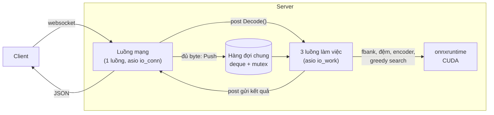

# Giai đoạn 1: server offline của sherpa-onnx hoạt động thế nào (17/10/2026)

Trước khi tối ưu, cần hiểu server gốc. Tài liệu này trả lời bốn câu hỏi:

1. Server gồm những phần nào.
2. Một request đi vào và đi ra như thế nào.
3. Bên trong dùng kỹ thuật gì.
4. Chịu tải tối đa bao nhiêu, và vì sao dừng ở đó.

Nguồn là code của sherpa-onnx v1.13.8, đúng bản đã đo. Các file chính:

- [offline-websocket-server.cc](https://github.com/k2-fsa/sherpa-onnx/blob/v1.13.8/sherpa-onnx/csrc/offline-websocket-server.cc) và [offline-websocket-server-impl.cc](https://github.com/k2-fsa/sherpa-onnx/blob/v1.13.8/sherpa-onnx/csrc/offline-websocket-server-impl.cc): mạng, hàng đợi, gom batch.
- [offline-recognizer-transducer-impl.h](https://github.com/k2-fsa/sherpa-onnx/blob/v1.13.8/sherpa-onnx/csrc/offline-recognizer-transducer-impl.h): giải mã một batch.
- [offline-transducer-model.cc](https://github.com/k2-fsa/sherpa-onnx/blob/v1.13.8/sherpa-onnx/csrc/offline-transducer-model.cc) và [offline-transducer-greedy-search-decoder.cc](https://github.com/k2-fsa/sherpa-onnx/blob/v1.13.8/sherpa-onnx/csrc/offline-transducer-greedy-search-decoder.cc): gọi model, greedy search.
- [offline-stream.cc](https://github.com/k2-fsa/sherpa-onnx/blob/v1.13.8/sherpa-onnx/csrc/offline-stream.cc) và [session.cc](https://github.com/k2-fsa/sherpa-onnx/blob/v1.13.8/sherpa-onnx/csrc/session.cc): tính đặc trưng âm thanh, cấu hình onnxruntime.

Số đo trong tài liệu lấy từ lần đo ở [README](README.md): server C++ gốc, cấu hình mặc định, RTX 3060 12 GB.

## Server gồm những phần nào



| Phần | Làm gì | Mặc định |
|---|---|---|
| Luồng mạng | Nhận và gửi mọi message websocket, giữ bộ đệm audio của từng kết nối | `--num-io-threads=1` |
| Hàng đợi | Một `std::deque` chung cho mọi kết nối, khóa bằng mutex, không giới hạn độ dài | |
| Luồng làm việc | Lấy câu từ hàng đợi, tính đặc trưng, giải mã cả batch, đẩy kết quả cho luồng mạng | `--num-work-threads=3`, `--max-batch-size=5` |
| Recognizer | Một bộ model dùng chung cho cả 3 luồng: encoder, decoder, joiner, mỗi cái một session onnxruntime | `--num-threads=2`, `--provider=cpu` (bọn mình chạy `cuda`) |

Luồng mạng và luồng làm việc nằm ở hai `asio::io_context` riêng (`io_conn` và `io_work`). Nhờ vậy việc nhận audio của người
khác không bao giờ phải chờ GPU.

Model là Zipformer gốc tiếng Anh (`sherpa-onnx-zipformer-en-2023-06-26`), dạng transducer, gồm ba file ONNX:

| File | Tham số | Số node ONNX | Vào → ra |
|---|---:|---:|---|
| encoder | 64.3M | 7,673 | đặc trưng `[N, T, 80]` → `[N, T/4, 512]`, tức 25 khung mỗi giây audio |
| decoder | 0.5M | 20 | 2 token gần nhất `[N, 2]` → `[N, 512]` |
| joiner | 0.3M | 3 | một khung encoder + đầu ra decoder → điểm của 500 token |

## Một request đi vào và đi ra như thế nào

**1. Kết nối.** Client mở websocket. `OnOpen` tạo một `ConnectionData` cho kết nối đó và ghi log số kết nối. Không có
giới hạn số kết nối.

**2. Gửi audio.** Giao thức rất đơn giản:

```
[4 byte: sample rate][4 byte: số byte audio][sample float32 trong khoảng ±1 ...]
```

- Không gửi header WAV, chỉ gửi sample.
- Client được cắt luồng byte thành bao nhiêu message cũng được; client mẫu của sherpa cắt mẩu 10240 byte. Câu 10 s là
  640 KB, tức 63 message.
- Message đầu tiên phải đủ 8 byte. Server đọc độ dài, cấp sẵn bộ đệm đúng cỡ, rồi chép dần từng message vào.
- Câu dài hơn `--max-utterance-length` (300 s) bị đóng kết nối với mã 1009.
- Sample rate khác 16 kHz thì server tự resample.

**3. Đủ byte thì vào hàng đợi.**

- Server chuyển bộ đệm sang một object mới, đưa vào hàng đợi chung (`Push`), rồi xóa bộ đệm của kết nối. Nhờ vậy cùng
  kết nối đó gửi được câu tiếp theo mà không phải mở lại.
- Mỗi câu vào hàng đợi kèm một lệnh `Decode()` gửi sang nhóm luồng làm việc.

**4. Một luồng làm việc nhận lệnh `Decode()`.**

```cpp
std::unique_lock<std::mutex> lock(mutex_);
if (streams_.empty()) return;                       // luồng khác đã lấy hết
int32_t size = std::min(streams_.size(), max_batch_size);
for (i = 0; i < size; ++i) {
  ... streams_.pop_front();
  s->AcceptWaveform(sample_rate, samples, n);       // tính fbank, vẫn đang giữ khóa
}
lock.unlock();
recognizer_.DecodeStreams(p_ss.data(), size);       // giải mã cả batch, không giữ khóa
```

Đoạn này có ba điểm đáng chú ý:

- **Không chờ cho đủ batch.** Luồng lấy hết những câu đang có, tối đa 5, rồi chạy luôn. Lúc vắng, batch chỉ có 1 câu nên
  trả lời nhanh. Lúc đông, hàng đợi dồn lên nên batch tự đủ 5.
- **Lệnh thừa.** Mỗi câu gửi một lệnh `Decode()`, nhưng một lệnh có thể lấy 5 câu. Các lệnh đến sau thấy hàng đợi rỗng
  thì thoát luôn.
- **Tính fbank trong lúc giữ khóa.** Tính đặc trưng chạy trên CPU khi vẫn khóa hàng đợi. Trong lúc đó hai luồng còn lại
  không lấy được câu mới.

**5. Giải mã một batch** (`DecodeStreams`, các luồng gọi song song, onnxruntime cho phép):

1. **Đặc trưng.** Mỗi câu là fbank 80 chiều, cửa sổ 25 ms, bước 10 ms, tức 100 khung mỗi giây (kaldi-native-fbank, trên
   CPU).
2. **Đệm.** Mọi câu được đệm bằng giá trị log(1e-10) cho bằng câu dài nhất, thành một tensor `[N, T_max, 80]` kèm độ dài
   thật của từng câu.
3. **Encoder.** Chạy một lần cho cả batch: 7,673 node, một lệnh `Run` của onnxruntime. Encoder tính cả phần đệm.
4. **Greedy search.** Câu được sắp theo độ dài (`PackPaddedSequence`), rồi lặp qua từng khung đầu ra, 25 khung mỗi giây
   audio:

   ```cpp
   for (auto n : packed_encoder_out.batch_sizes) {   // một vòng cho mỗi khung, tới hết câu dài nhất
     logit = RunJoiner(khung t của n câu còn chạy, decoder_out);   // 1 lệnh Run lên GPU
     for (i < n) y = argmax(log_softmax(logit[i]));              // trên CPU
     if (có câu nào ra token khác blank)
       decoder_out = RunDecoder(2 token cuối của n câu);          // thêm 1 lệnh Run
   }
   ```

   - Câu nào hết khung thì rời vòng lặp, nên joiner chỉ tính các câu còn chạy.
   - Nhưng số vòng bằng số khung của câu dài nhất: câu 10 s là 250 vòng, câu 33 s là khoảng 825 vòng.
5. **Thành chữ.** Ghép các token BPE thành chữ, tính mốc thời gian (40 ms mỗi khung).

**6. Trả kết quả.** Xong batch, luồng làm việc gửi từng kết quả sang luồng mạng (`asio::post`). Luồng mạng gửi một message
JSON:

```json
{"lang": "", "emotion": "", "event": "", "text": " IT IS A GLEANER BRINGING DOWN ...",
 "timestamps": [0.00, 0.12, ...], "durations": [], "tokens": [" IT", " IS", ...],
 "ys_log_probs": [-0.01, ...], "words": []}
```

- `text`: kết quả.
- `timestamps`: thời điểm bắt đầu của từng token, tính bằng giây.
- `ys_log_probs`: log xác suất của từng token.
- Các trường `lang`, `emotion`, `event` để trống: Zipformer không có các thông tin này.

Cả batch trả cùng lúc: câu ngắn phải chờ câu dài nhất trong batch (xem
[README](README.md#khi-đông-người-kết-quả-trả-về-thế-nào)).

**7. Kết thúc.** Client gửi câu tiếp theo trên cùng kết nối, hoặc gửi chữ `Done`. Nhận `Done` thì server đóng kết nối.

## Kỹ thuật bên trong

| Kỹ thuật | Trong code | Tác dụng | Cái giá |
|---|---|---|---|
| Tách luồng mạng và luồng tính | hai `asio::io_context` | Nhận audio không bị chặn bởi GPU | |
| Gom batch động, không chờ | `min(số câu đang chờ, 5)` | Vắng thì trả nhanh, đông thì batch tự lớn | Batch tối đa 5, cố định khi chạy |
| 3 luồng cùng giải mã | 3 luồng gọi `DecodeStreams` trên cùng model | Phần CPU của batch này chạy chồng lên phần GPU của batch khác | Tối đa 15 câu được giải mã cùng lúc |
| Đệm theo câu dài nhất | `PadSequence` với log(1e-10) | Encoder chạy cả batch trong một lần | Encoder tính phần đệm vô ích |
| Bỏ câu đã xong khỏi vòng lặp | `PackPaddedSequence` | Joiner chỉ tính các câu còn chạy | Số vòng lặp vẫn theo câu dài nhất |
| Chọn thuật toán cuDNN bằng heuristic | `OrtCudnnConvAlgoSearchHeuristic` | Không phải dò thuật toán cho mỗi độ dài mới (chế độ dò kỹ "cực kỳ chậm", theo comment trong code) | |
| Dữ liệu vào ra mỗi lần chạy nằm ở CPU | `Ort::AllocatorWithDefaultOptions`, không dùng IOBinding | Code đơn giản | Mỗi lệnh `Run` phải chép CPU → GPU → CPU rồi chờ GPU xong |

Hệ quả của hai dòng cuối, tính cho một câu 10 s chạy một mình:

- **Encoder:** 1 lần, nhưng là đồ thị 7,673 node.
- **Joiner:** 250 lần. Mỗi lần chỉ nhân vài ma trận nhỏ, nhưng phải chép dữ liệu qua lại và chờ GPU.
- **Decoder:** thêm vài chục lần, mỗi khi có token mới.

Phần lớn thời gian khả năng cao là CPU ra lệnh và chờ, không phải GPU tính. Đây là suy luận từ code và từ số đo bên
dưới; chưa profile để tách riêng từng phần.

## Chịu tối đa bao nhiêu, và vì sao

### Giới hạn có sẵn trong code

- **Tối đa 15 câu được giải mã cùng lúc:** 3 luồng làm việc, mỗi luồng tối đa 5 câu. Câu thứ 16 trở đi xếp hàng.
- **Hàng đợi không giới hạn, server không bao giờ từ chối.** Quá tải thì thời gian chờ tăng mãi chứ không báo lỗi. Khi
  đo, 34,666 request đều thành công, kể cả lúc P90 thời gian chờ lên tới hơn 27 s.
- **Chỉ từ chối câu dài hơn 300 s.**
- **Bộ nhớ GPU chỉ tăng, không giảm.** Lúc đầu 0.7–1.3 GB, lên 2.4 GB với batch 5 câu 10 s, lên 5.5–6.6 GB sau khi gặp
  batch có câu dài tới 33 s. onnxruntime giữ lại vùng nhớ đã cấp để dùng lại.

### Chi phí một câu

Thời gian giải mã khi chỉ có một câu, đo trên 300 câu chạy lần lượt từng câu:

| Độ dài câu | Thời gian | Tính trên mỗi giây audio |
|---|---:|---:|
| dưới 5 s | 104 ms | 32 ms |
| 5–10 s | 124 ms | 18 ms |
| 10–15 s | 148 ms | 13 ms |
| 15–20 s | 172 ms | 10 ms |
| 20–33 s | 222 ms | 9 ms |

Gần đúng: **khoảng 90 ms cố định + 5 ms cho mỗi giây audio.**

- **Phần cố định** không phụ thuộc độ dài. Khả năng cao là chi phí phát lệnh cho đồ thị encoder 7,673 node và các lần chép
  dữ liệu.
- **Phần theo độ dài** khớp với vòng greedy search: 25 vòng mỗi giây audio, mỗi vòng khoảng 0.2 ms.
- Vì phần cố định lớn, **câu ngắn đắt hơn câu dài** nếu tính trên mỗi giây audio.

### Trần đo được

| Kịch bản | Trần xử lý | Lúc đó batch trung bình | GPU bận | CPU server |
|---|---:|---:|---:|---:|
| Nói liên tục, câu ~10 s | ~515 giây audio mỗi giây | 5.0 | 60–63% | 2.8 nhân |
| Gửi cùng lúc, câu ~10 s (128 người) | 422 giây audio mỗi giây | 4.6 | 46% | 2.5 nhân |
| Gửi cùng lúc, câu 1.4–33 s (128 người) | 282 giây audio mỗi giây | 4.6 | 40% | 2.3 nhân |
| Nói liên tục, câu 1.4–33 s | ~112 giây audio mỗi giây | 3.9 | 24% | 1.9 nhân |

Đổi ra số người dùng (P90 ≤ 1 s):

- Câu ~10 s: 24 người gửi cùng lúc, hoặc 128 người nói liên tục.
- Câu lẫn lộn: 16 người gửi cùng lúc, hoặc 64 người nói liên tục.

Bảng đầy đủ ở [README](README.md#kết-quả).

### Vì sao dừng ở đó

- **Batch có giúp, nhưng chỉ tới 5.**
  - Một câu 10 s chạy một mình mất ~0.13 s (P50 của 55 câu, tính cả gửi và nhận).
  - Ở trần ~515 giây audio mỗi giây với 3 luồng, mỗi batch 5 câu 10 s mất khoảng 3 × 50 s / 515 ≈ 0.29 s, tức chỉ gấp
    khoảng 2.2 lần một câu lẻ. Tính trên mỗi câu, batch rẻ hơn khoảng 2.3 lần.
  - Batch lớn hơn có thể còn rẻ hơn nữa, nhưng `--max-batch-size=5` chặn lại. Chưa đo batch lớn hơn.
- **GPU không bận hết.** Ngay ở trần, GPU chỉ bận 24–63%. Thời gian còn lại GPU chờ CPU: chờ lệnh, chờ chép dữ liệu, chờ
  argmax trên CPU sau mỗi khung, chờ tính fbank đang giữ khóa.
- **Câu lẫn lộn tụt khoảng 4 lần**, vì mấy lý do cộng lại:
  - **Đệm:** GPU phải tính 1.86 lần lượng audio thật (đo ở README).
  - **Vòng lặp dài:** số vòng greedy search theo câu dài nhất trong batch.
  - **Câu ngắn đắt:** câu trung bình ngắn hơn (7.2 s so với 10 s), nên phần 90 ms cố định chia cho ít giây audio hơn.

  Ba lý do này chưa giải thích hết mức tụt; phần còn lại chưa đo.

## Điểm nghẽn để làm bản lite

Đây là các giả thuyết rút ra từ code và số đo, cần profile để xác nhận trước khi sửa:

1. **Vòng greedy search phát hàng trăm lệnh nhỏ cho mỗi câu,** mỗi lệnh đều chép dữ liệu qua lại và chờ GPU. Cách sửa
   tiềm năng: giữ dữ liệu trên GPU (IOBinding), làm argmax trên GPU, hoặc gộp cả vòng lặp thành một đồ thị.
2. **Encoder có phần chi phí cố định lớn** (~90 ms mỗi lần chạy, đồ thị 7,673 node). Cách sửa tiềm năng: CUDA graph hoặc
   TensorRT, như cách vieneu xử lý codec.
3. **Batch nhỏ và trộn độ dài.** Cách sửa tiềm năng: batch lớn hơn, và gom các câu có độ dài gần nhau.
4. **Tính fbank trong lúc giữ khóa hàng đợi.** Cách sửa tiềm năng: tính fbank ngay khi nhận đủ audio, trước khi vào hàng đợi.
5. **Không có giới hạn tải.** Quá tải thì ai cũng chờ lâu. Bản phục vụ thật cần từ chối bớt hoặc báo bận.

Bước tiếp theo: profile server gốc trên GPU (nsys, profiler của onnxruntime) để biết thời gian của một batch chia cho
fbank, encoder và greedy search bao nhiêu, rồi mới chọn chỗ sửa.
