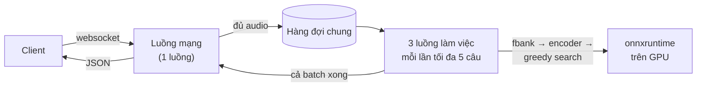

# Giai đoạn 1: server offline của sherpa-onnx và số đo baseline (17/10/2026)

Giai đoạn này có ba việc:

1. Đọc code server offline của sherpa-onnx để hiểu nó nhận audio, gom batch và trả chữ như thế nào.
2. Viết một bản Python dịch đúng logic server C++ đó, vì Python dễ sửa để làm bản lite sau này.
3. Đo cả hai trên cùng một GPU thuê, ở nhiều mức người dùng, với hai kiểu độ dài câu.

## Server sherpa-onnx xử lý một câu như thế nào

Code đọc từ sherpa-onnx v1.13.8, bản đã đo:
[offline-websocket-server-impl.cc](https://github.com/k2-fsa/sherpa-onnx/blob/v1.13.8/sherpa-onnx/csrc/offline-websocket-server-impl.cc),
[offline-recognizer-transducer-impl.h](https://github.com/k2-fsa/sherpa-onnx/blob/v1.13.8/sherpa-onnx/csrc/offline-recognizer-transducer-impl.h),
[offline-transducer-greedy-search-decoder.cc](https://github.com/k2-fsa/sherpa-onnx/blob/v1.13.8/sherpa-onnx/csrc/offline-transducer-greedy-search-decoder.cc).



Đường đi của một câu:

1. **Gửi audio.** Client gửi 4 byte sample rate, 4 byte độ dài, rồi các sample float32, cắt thành nhiều mẩu. Client mẫu
   của sherpa cắt mẩu 10240 byte, nên câu 10 s là 63 mẩu. Luồng mạng ghép các mẩu lại. Đủ byte thì câu vào hàng đợi
   chung, và một lệnh giải mã được gửi cho nhóm luồng làm việc.
2. **Gom batch.** Một luồng làm việc lấy hết các câu đang chờ, tối đa 5, không chờ cho đủ. Lúc vắng, batch chỉ 1 câu nên
   trả lời nhanh. Lúc đông, hàng đợi dồn lên nên batch tự đủ 5.
3. **Đặc trưng.** Mỗi câu thành fbank 80 chiều, 100 khung mỗi giây, tính trên CPU. Đoạn này chạy trong lúc vẫn khóa hàng
   đợi, nên hai luồng kia phải chờ.
4. **Encoder.** Các câu được đệm cho bằng câu dài nhất, rồi chạy encoder một lần cho cả batch. Encoder Zipformer có 64M
   tham số, 7,673 node ONNX, ra 25 khung mỗi giây audio.
5. **Greedy search.** Lặp qua từng khung, tới hết câu dài nhất: câu 10 s là 250 vòng, câu 33 s là khoảng 825 vòng.
   - Mỗi vòng gọi joiner (0.3M tham số) một lần cho các câu còn chạy, rồi chọn token có điểm cao nhất trên CPU.
   - Vòng nào có token mới thì gọi thêm decoder (0.5M tham số).
   - Mỗi lần gọi model, dữ liệu đi từ CPU sang GPU rồi về lại CPU.
6. **Trả kết quả.** Cả batch xong mới gửi, và gửi cả 5 kết quả cùng lúc, mỗi kết quả là một message JSON (`text`,
   `timestamps`, `tokens`, `ys_log_probs`, …).

Giới hạn có sẵn trong code:

- **Tối đa 15 câu được giải mã cùng lúc** (3 luồng × 5 câu). Câu thứ 16 trở đi xếp hàng.
- **Hàng đợi không giới hạn.** Quá tải thì thời gian chờ tăng mãi, không bao giờ báo lỗi.
- **Chỉ từ chối câu dài hơn 300 s.**

## Hai bản để so

| | C++ gốc | Python port |
|---|---|---|
| Code | `sherpa-onnx-offline-websocket-server`, binary build sẵn của release v1.13.8 (CUDA 12, cuDNN 9), chạy nguyên | [server_python.py](baseline/server_python.py), dịch từ file C++ cùng phiên bản |
| Engine | onnxruntime 1.28.2, CUDA | onnxruntime 1.28.2, CUDA (wheel `sherpa-onnx==1.13.8+cuda12.cudnn9`) |
| Cấu hình | mặc định: batch tối đa 5, 3 luồng làm việc, 2 luồng onnxruntime | giống hệt |

Cả hai cùng giao thức, cùng flag, cùng cách gom batch. Điều kiện để dùng bản Python làm baseline: phải chạy ngang bản C++.

Model là Zipformer gốc tiếng Anh
([sherpa-onnx-zipformer-en-2023-06-26](https://k2-fsa.github.io/sherpa/onnx/pretrained_models/offline-transducer/zipformer-transducer-models.html)):

- Checkpoint gốc của icefall (`Zengwei/icefall-asr-librispeech-zipformer-2023-05-15`), bản medium, train trên LibriSpeech.
- Tác giả sherpa export ra ONNX, không train lại. Chạy fp32, giải mã greedy search.

## Kết quả

### Phương pháp đo

**Thước đo**

- **Latency:** thời gian tới khi nhận được chữ. ASR offline trả cả câu một lần, nên đây cũng là thời gian tới chữ đầu tiên,
  tương đương TTFA ở vieneu.
  - Gửi cùng lúc: tính từ byte đầu tiên gửi đi.
  - Nói liên tục: tính từ lúc câu nói xong, gồm cả thời gian xếp hàng.
- **RTF:** latency chia độ dài câu, càng nhỏ càng tốt. RTF 0.1 nghĩa là câu 10 s có chữ sau 1 s.
- **Xử lý:** số giây audio server chép ra chữ trong một giây.
- **WER:** tỉ lệ từ sai so với transcript gốc của LibriSpeech.

P50/P90 tính trên mọi request của một mức, nội suy tuyến tính như ở vieneu.

**Audio**

LibriSpeech test-clean, tức câu tiếng Anh đọc thật, bộ test chuẩn của chính model này. [audio.py](baseline/audio.py) chọn
hai bộ:

| Bộ | Câu | Độ dài |
|---|---:|---|
| Câu ~10 s | 55, tất cả các câu dài 9.75–10.25 s | trung bình 10.00 s |
| Câu 1.4–33 s | 300, lấy ngẫu nhiên (seed 0) trong 2620 câu | 1.42–32.77 s, trung bình 7.23 s |

Những người gửi cùng lúc luôn gửi các câu khác nhau.

**Hai kịch bản tải**

| | Gửi cùng lúc | Nói liên tục |
|---|---|---|
| Cách gửi | N người gửi một câu đúng cùng lúc. 2 lượt khởi động, rồi 5 lượt đo | N người nói không nghỉ. Câu nào nói xong gửi ngay, mỗi người chỉ có một câu đang chờ. Người dùng bắt đầu lệch nhau |
| Thời gian | Đến khi đủ 5 lượt | 60 s mỗi mức, bỏ 10 s đầu |
| Các mức N | 1, 2, 4, 8, 16, 24, 32, 48, 64, 96, 128 | 32, 64, 128, 192, …; dừng khi P90 quá 5 s |

Kịch bản nói liên tục coi như có một VAD hoàn hảo: cắt đúng cuối câu, không tốn thời gian. Thực tế VAD phải đợi im lặng
vài trăm ms mới cắt, nên latency thật sẽ cao hơn. Chưa đo.

**Nơi chạy client**

- Client đo ([loadtest.py](baseline/loadtest.py)) chạy ngay trên máy GPU, chia người dùng cho 8 tiến trình. Độ trễ mạng
  giữa máy mình và máy GPU không lọt vào số nào.
- Client nói đúng giao thức của client mẫu sherpa. Mỗi người giữ một kết nối suốt một mức tải.
- [bench.py](baseline/bench.py) trên máy GPU bật server cần đo, chạy client và trả file kết quả. Nó không nằm trên đường
  đi của request.

**Máy đo**

| Thông số | Giá trị |
|---|---|
| GPU | NVIDIA GeForce RTX 3060 12 GB, driver 580.126.20, giới hạn công suất 170 W |
| GPU UUID | `GPU-5cc6a8b4-ff0b-0ab0-21ca-3b4128a5a0e7` |
| CPU | 24 nhân, container `8e87f284f6e3` |
| Máy thuê | VKong `vk_8b2b7bfcf4da4545`, Hàn Quốc, $0.084/giờ |
| Image | `pytorch/pytorch:2.8.0-cuda12.8-cudnn9-runtime`, Python 3.11.13 |
| Xung nhịp GPU | Không khóa được (máy thuê từ chối `nvidia-smi -lgc`); 1807–1957 MHz trong lúc đo |
| Nhiệt độ GPU | 45–76 °C trong lúc đo |
| Thứ tự | C++ đo trước (16:33–17:41), Python đo sau (17:41–18:01) |

Tổng cộng 34,666 request, không lỗi nào. Máy chạy khoảng 2 giờ 46 phút kể cả cài đặt, hết khoảng $0.23.

### Một request mỗi lúc

Mỗi câu gửi một mình, lần lượt từng câu, 300 câu:

| Độ dài câu | Số câu | Latency P50 / P90, C++ gốc | Latency P50 / P90, Python | RTF P50, C++ gốc | RTF P50, Python |
|---|---:|---:|---:|---:|---:|
| 0–5 s | 126 | 104 / 112 ms | 108 / 118 ms | 0.032 | 0.033 |
| 5–10 s | 112 | 124 / 135 ms | 131 / 144 ms | 0.018 | 0.019 |
| 10–15 s | 33 | 148 / 163 ms | 161 / 178 ms | 0.013 | 0.014 |
| 15–20 s | 20 | 172 / 185 ms | 189 / 205 ms | 0.010 | 0.011 |
| 20–33 s | 9 | 222 / 236 ms | 242 / 272 ms | 0.009 | 0.010 |

- Gần đúng: **khoảng 90 ms cố định cộng 5 ms cho mỗi giây audio.** Câu ngắn có RTF cao hơn câu dài vì phần cố định.
- Bản Python chậm hơn C++ khoảng 4–10%.
- WER chạy riêng là 2.20% trên bộ 300 câu, khớp số icefall công bố cho đúng checkpoint này (2.22–2.27% với greedy search
  trên toàn bộ test-clean).

### Gửi cùng lúc, câu ~10 s

| Người dùng cùng lúc | Latency P50 / P90, C++ gốc | Latency P50 / P90, Python | RTF P50 / P90, C++ gốc | RTF P50 / P90, Python |
|---:|---:|---:|---:|---:|
| 1 | 0.13 / 0.15 s | 0.14 / 0.14 s | 0.013 / 0.015 | 0.014 / 0.014 |
| 2 | 0.18 / 0.19 s | 0.23 / 0.23 s | 0.018 / 0.019 | 0.023 / 0.024 |
| 4 | 0.30 / 0.38 s | 0.26 / 0.28 s | 0.030 / 0.038 | 0.026 / 0.029 |
| 8 | 0.53 / 0.75 s | 0.48 / 1.00 s | 0.053 / 0.075 | 0.048 / 0.098 |
| 16 | 0.68 / 0.87 s | 0.71 / 1.04 s | 0.067 / 0.086 | 0.071 / 0.105 |
| 24 | 0.71 / 0.99 s | 0.77 / 1.28 s | 0.072 / 0.099 | 0.077 / 0.127 |
| 32 | 0.96 / 1.33 s | 1.26 / 1.72 s | 0.096 / 0.134 | 0.126 / 0.170 |
| 48 | 1.01 / 1.43 s | 1.46 / 2.03 s | 0.101 / 0.142 | 0.147 / 0.203 |
| 64 | 1.11 / 1.65 s | 1.59 / 2.22 s | 0.111 / 0.165 | 0.160 / 0.224 |
| 96 | 1.38 / 2.08 s | 2.35 / 3.19 s | 0.139 / 0.208 | 0.233 / 0.319 |
| 128 | 1.81 / 2.75 s | 2.55 / 3.78 s | 0.180 / 0.275 | 0.257 / 0.380 |

Ở 128 người, C++ xử lý 422 giây audio mỗi giây, Python 304.

### Gửi cùng lúc, câu 1.4–33 s

| Người dùng cùng lúc | Latency P50 / P90, C++ gốc | Latency P50 / P90, Python | RTF P50 / P90, C++ gốc | RTF P50 / P90, Python |
|---:|---:|---:|---:|---:|
| 1 | 0.13 / 0.19 s | 0.13 / 0.21 s | 0.014 / 0.017 | 0.014 / 0.018 |
| 2 | 0.16 / 0.22 s | 0.18 / 0.24 s | 0.019 / 0.058 | 0.021 / 0.066 |
| 4 | 0.26 / 0.38 s | 0.28 / 0.42 s | 0.032 / 0.079 | 0.030 / 0.098 |
| 8 | 0.49 / 0.62 s | 0.29 / 0.59 s | 0.060 / 0.096 | 0.047 / 0.069 |
| 16 | 0.46 / 0.77 s | 0.46 / 0.68 s | 0.083 / 0.124 | 0.072 / 0.130 |
| 24 | 0.56 / 1.16 s | 0.53 / 0.92 s | 0.102 / 0.151 | 0.094 / 0.164 |
| 32 | 0.57 / 1.22 s | 0.68 / 1.11 s | 0.112 / 0.168 | 0.111 / 0.230 |
| 48 | 0.76 / 1.25 s | 0.76 / 1.55 s | 0.124 / 0.175 | 0.121 / 0.248 |
| 64 | 0.89 / 1.98 s | 1.07 / 2.10 s | 0.147 / 0.207 | 0.178 / 0.334 |
| 96 | 1.30 / 2.36 s | 1.28 / 2.52 s | 0.205 / 0.284 | 0.209 / 0.434 |
| 128 | 1.51 / 2.81 s | 1.45 / 2.85 s | 0.239 / 0.304 | 0.237 / 0.442 |

- Câu dài chờ lâu hơn. Ở 64 người, latency P90 của C++ là 0.82 s với câu dưới 5 s, nhưng 2.49 s với câu trên 20 s.
- Ở 128 người, C++ xử lý 282 giây audio mỗi giây, Python 260.

### Nói liên tục, câu ~10 s

| Người dùng cùng lúc | Latency P50 / P90, C++ gốc | Latency P50 / P90, Python | RTF P50 / P90, C++ gốc | RTF P50 / P90, Python | Xử lý, C++ / Python |
|---:|---:|---:|---:|---:|---:|
| 32 | 0.15 / 0.19 s | 0.17 / 0.23 s | 0.015 / 0.019 | 0.017 / 0.024 | 32 / 32 s/giây |
| 64 | 0.22 / 0.71 s | 0.25 / 0.72 s | 0.022 / 0.071 | 0.025 / 0.072 | 64 / 64 s/giây |
| 128 | 0.33 / 0.77 s | 0.49 / 0.92 s | 0.034 / 0.077 | 0.049 / 0.091 | 127 / 127 s/giây |
| 192 | 0.86 / 1.31 s | 0.86 / 1.24 s | 0.086 / 0.130 | 0.085 / 0.125 | 194 / 190 s/giây |
| 256 | 0.91 / 1.31 s | 1.37 / 2.07 s | 0.091 / 0.131 | 0.137 / 0.207 | 253 / 254 s/giây |
| 320 | 0.87 / 1.28 s | 2.62 / 3.54 s | 0.087 / 0.128 | 0.262 / 0.354 | 317 / 309 s/giây |
| 384 | 0.85 / 1.20 s | 6.09 / 8.72 s | 0.085 / 0.120 | 0.611 / 0.872 | 387 / 357 s/giây |
| 448 | 0.99 / 1.58 s | — | 0.099 / 0.158 | — | 449 / — s/giây |
| 512 | 1.32 / 1.73 s | — | 0.132 / 0.172 | — | 506 / — s/giây |
| 640 | 9.46 / 14.26 s | — | 0.939 / 1.419 | — | 515 / — s/giây |

N người nói không nghỉ tạo ra N giây audio mỗi giây. Khi cột "Xử lý" thấp hơn N, server đã quá tải và latency tăng không
dừng: C++ quá tải ở 640 người (trần ~515 giây audio mỗi giây), Python ở 384 người (~360).

### Nói liên tục, câu 1.4–33 s

| Người dùng cùng lúc | Latency P50 / P90, C++ gốc | Latency P50 / P90, Python | RTF P50 / P90, C++ gốc | RTF P50 / P90, Python | Xử lý, C++ / Python |
|---:|---:|---:|---:|---:|---:|
| 32 | 0.16 / 0.25 s | 0.18 / 0.26 s | 0.028 / 0.059 | 0.031 / 0.062 | 32 / 32 s/giây |
| 64 | 0.20 / 0.33 s | 0.21 / 0.46 s | 0.034 / 0.080 | 0.036 / 0.103 | 63 / 63 s/giây |
| 128 | 3.56 / 7.03 s | 0.95 / 1.59 s | 0.479 / 2.230 | 0.141 / 0.411 | 112 / 124 s/giây |
| 192 | — | 12.23 / 27.73 s | — | 1.821 / 8.351 | — / 132 s/giây |

- Trần chỉ còn khoảng 112–132 giây audio mỗi giây, thấp hơn khoảng 4 lần so với câu ~10 s.
- Giữa 64 và 128 người chưa đo, nên sức chứa thật nằm đâu đó trong khoảng này.

### Tóm tắt: số người dùng tối đa

Mức cao nhất đã đo mà không có lỗi và latency P90 không quá ngưỡng:

| Kịch bản | P90 ≤ 1 s, C++ gốc | P90 ≤ 1 s, Python | P90 ≤ 2 s, C++ gốc | P90 ≤ 2 s, Python |
|---|---:|---:|---:|---:|
| Gửi cùng lúc, câu ~10 s | 24 | 8 | 64 | 32 |
| Gửi cùng lúc, câu 1.4–33 s | 16 | 24 | 64 | 48 |
| Nói liên tục, câu ~10 s | 128 | 128 | 512 | 192 |
| Nói liên tục, câu 1.4–33 s | 64 | 64 | 64 | 128 |

WER lúc có tải ở mọi mức đều bằng lúc chạy riêng (1.9–2.3%): tải nặng không làm sai chữ.

### C++ so với Python

**Bản Python chưa ngang C++, nên baseline là server C++ gốc.**

- **Tải thấp** (tới 8 người gửi cùng lúc, tới 128 người nói liên tục): hai bản gần như nhau, Python chậm hơn 4–10%.
- **Gửi cùng lúc, câu ~10 s:** từ 16 người trở lên, Python chậm hơn ở mọi mức. Mốc P90 ≤ 1 s của Python rơi ở 8 người
  thay vì 24.
- **Tải cao với câu ~10 s:** Python chỉ đạt khoảng 70% trần xử lý của C++ (304 so với 422 khi gửi cùng lúc; ~360 so với
  ~515 khi nói liên tục).
- **Câu lẫn lộn:** hai bản ngang nhau trong biên độ dao động. Ở 128 người nói liên tục, C++ sập còn Python trụ được, vì
  tải đang sát trần của cả hai.

Model và engine bên dưới là một, nên phần chậm hơn nằm ở lớp Python. Chưa đo cụ thể chỗ nào. Ứng viên là vòng asyncio
duy nhất phải nhận từng mẩu 10 KB, và đoạn giữ GIL khi đổi mảng numpy sang C++.

### Khi đông người, kết quả trả về theo từng batch

Kết quả không về cùng lúc cho cả N người, cũng không phải câu nào xong trả câu đó:

- Cả batch tối đa 5 câu trả về cùng lúc khi batch xong.
- Ba batch chạy song song; batch nào xong trước thì 5 người đó nhận trước.

Ví dụ một lượt 128 người gửi cùng lúc, câu 1.4–33 s, server C++:

| Đợt | Trả về lúc | Số request | Độ dài các câu |
|---:|---:|---:|---|
| 1 | 0.21 s | 1 | 2.1 s |
| 2 | 0.22 s | 1 | 2.2 s |
| 3 | 0.23 s | 1 | 1.9 s |
| 4 | 0.41 s | 5 | 2.0, 2.0, 2.4, 2.6, 2.7 s |
| … | | | |
| 27 | 3.42 s | 5 | 14.4, 15.9, 16.7, 18.0, 18.6 s |
| 28 | 3.54 s | 5 | 18.1, 19.1, 19.9, 22.6, 28.6 s |

128 người nhận kết quả rải ra 28 đợt, từ 0.21 s tới 3.54 s.

Câu ngắn có bị câu dài chặn không:

- **Chung batch với câu dài: thiệt ít.** Câu ngắn phải chờ câu dài nhất trong batch. Ở 64 người nói liên tục, chỉ khoảng 12%
  câu dưới 5 s bị chung batch với câu dài gấp đôi trở lên, và mỗi lần chỉ chậm thêm khoảng 0.1 s.
- **Xếp hàng: thiệt nhiều khi quá tải.** Hàng đợi làm theo thứ tự tới trước, không ưu tiên câu ngắn. Ở 128 người nói
  liên tục, câu dưới 5 s chờ trung vị 2.87 s, trong khi chạy một mình chỉ mất 0.10 s.
- **Đệm làm phí GPU.** Khi nói liên tục với câu lẫn lộn, câu đến ngẫu nhiên nên một batch có thể gồm câu 1.7, 2.0, 3.2,
  4.3 và 14.4 s. GPU phải tính 1.86 lần lượng audio thật. Khi gửi cùng lúc thì chỉ 1.17 lần, vì câu ngắn tải lên xong
  trước nên tự gom với câu ngắn.

### Vì sao sức chứa dừng ở đó

Đây là suy luận từ code và từ số đo ở trên, chưa profile:

- **GPU không bận hết.** Ngay ở trần, GPU chỉ bận 24–63% và server dùng 2–2.8 nhân CPU. Thời gian còn lại GPU chờ CPU:
  phát lệnh cho đồ thị encoder 7,673 node, chép dữ liệu qua lại sau mỗi vòng greedy search, chọn token trên CPU, tính fbank
  trong lúc giữ khóa.
- **Batch chỉ tới 5.** Một batch 5 câu 10 s mất khoảng 0.29 s, trong khi một câu lẻ mất ~0.13 s. Tính trên mỗi câu, batch
  rẻ hơn khoảng 2.3 lần. Batch lớn hơn có thể còn rẻ hơn, nhưng mặc định chặn ở 5.
- **Câu lẫn lộn tụt khoảng 4 lần,** vì ba lý do cộng lại: đệm (1.86 lần), vòng greedy search chạy theo câu dài nhất, và câu
  ngắn hơn nên phần 90 ms cố định chia cho ít giây audio hơn. Ba lý do này chưa giải thích hết mức tụt.
- **Bộ nhớ GPU chỉ tăng.** Từ 0.7–1.3 GB lúc đầu lên 6.6 GB sau khi gặp batch có câu 33 s; onnxruntime giữ lại vùng nhớ
  đã cấp.

### Giới hạn

- **Một máy, một lần đo mỗi mức, đo C++ xong mới tới Python.** Không đo xen kẽ như vieneu.
- **Ít request ở mức nhỏ.** Kịch bản gửi cùng lúc ở mức N có 5·N request; N nhỏ thì P90 chỉ dựa trên vài chục request.
- **Các mức đo còn thưa** ở kịch bản nói liên tục với câu lẫn lộn.
- **Chưa có VAD**, và người dùng nói liền không nghỉ, tức mức tải cao nhất có thể.
- **Mới đo cấu hình mặc định.** Chưa thử batch lớn hơn hay nhiều luồng hơn.

## Tự kiểm tra và chạy lại

### Tính lại các bảng (không cần GPU)

```bash
python3 experiments/baseline/analyze.py
```

Lệnh này in lại mọi bảng ở trên từ số đo thô trong [baseline/results/gpu-20261017/](baseline/results/gpu-20261017/):
mỗi request một dòng trong `<server>/<kịch bản>/c<N>.jsonl`, kèm `summary.json` có mẫu GPU và CPU mỗi giây.

### Chạy lại trên VKong

Cần CLI của VKong đã đăng nhập. Chạy từ thư mục gốc của repo, mất khoảng 2 giờ máy, dưới $0.25.

**Bước 1. Thuê máy.** Lệnh này cài thư viện, tải model, binary C++ và LibriSpeech, rồi chạy `bench.py`:

```bash
vkong run -C baseline --detach
vkong instances                      # lấy id của máy, dạng vk_xxxx
vkong attach vk_xxxx -C baseline     # in ra http://127.0.0.1:PORT; để cửa sổ này mở
```

**Bước 2. Đo cả hai server**, ở cửa sổ khác:

```bash
URL=http://127.0.0.1:PORT
bash experiments/baseline/run_suite.sh $URL cpp       # 4 kịch bản, server C++ gốc, khoảng 1 giờ
bash experiments/baseline/run_suite.sh $URL python    # 4 kịch bản, bản Python
```

- Muốn đổi cấu hình thì truyền ba số cuối, ví dụ `run_suite.sh $URL cpp 16 3 2` để đo với batch 16.
- Kết nối hay đứt (`Connection to the machine was lost`) trong khi máy vẫn chạy, nhưng phép đo vẫn chạy tiếp trên máy GPU.
  Nối lại bằng `vkong attach vk_xxxx -C baseline` (không có `--update`), rồi chạy tiếp phần còn lại, ví dụ
  `SCENARIOS="sustain-mixed" bash experiments/baseline/run_suite.sh $URL cpp`.

**Bước 3. Tải kết quả, trả máy, tính bảng.** `Ctrl+C` chỉ đóng kết nối, máy vẫn tính tiền tới khi `stop`:

```bash
python3 experiments/baseline/fetch.py $URL --run my-rerun
vkong app stop zipformer-asr-baseline --yes
python3 experiments/baseline/analyze.py --run my-rerun
```
